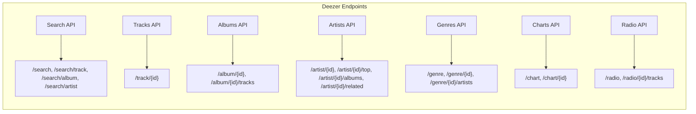
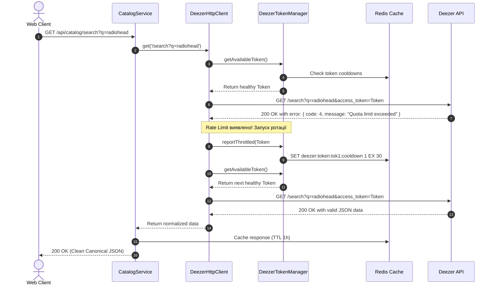

# Технічний дизайн: Задача 2 — Інтеграція сервісу Deezer API, каталог та ротація токенів при Rate Limit

**Статус:** Схвалено до реалізації  
**Дата:** 2026-10-31  
**Автор:** Sonora Engineering Team  
**Гілка:** `tech-design-2`

---

## 1. Мета та контекст (Overview & Context)

### 1.1. Номер задачі та назва

- **Задача 2**: Підключення сервісу Deezer API, повний опис ендпоінтів та розбір типів, реалізація адаптера/провайдера з пулом токенів і механізмом балансування/перемикання при перевищенні лімітів (Rate Limit / Quota Exceeded).

### 1.2. Посилання на ROADMAP.md

- [ROADMAP.md](../../ROADMAP.md):
  - **Розділ 7 (NestJS Domain Modules)**: Каталог є окремим ізольованим модулем (`CatalogModule`), що не залежить від деталей реалізації зовнішніх провайдерів.
  - **Розділ 15 (Catalog — Next Major Step)**:
    ```text
    Application → Catalog → MusicProvider → DeezerProvider → Deezer API
    ```
    Додаток Sonora категорично не повинен залежати від структури Deezer API напряму.
  - **Розділ 16 (MusicProvider Interface)**: Єдиний поліморфний контракт для всіх майбутніх музичних провайдерів (`DeezerProvider`, `TidalProvider`, `AppleMusicProvider`).
  - **Розділ 17 (Deezer DTO Layer)**:
    ```text
    Deezer API → Deezer DTO → DeezerMapper → Domain Model
    ```
    Суворе розділення сирих типів зовнішнього API (`DeezerTrackDto`, `DeezerAlbumDto`, `DeezerArtistDto`) та канонічних сутностей Sonora.
  - **Розділи 18–20 (Canonical Models)**: Канонічні контракти сутностей `Track`, `Artist`, `Album`, `Genre`.
  - **Розділ 21 (Images)**: Уніфікований інтерфейс обкладинок та фотографій `ImageSet` (`small`, `medium`, `large`, `xl`).
  - **Розділ 22 (Summary vs Details)**: Розділення легковагих спискових моделей (`TrackSummary`, `AlbumSummary`, `ArtistSummary`) та повноцінних моделей деталей (`TrackDetails`, `AlbumDetails`, `ArtistDetails`).
  - **Розділ 23 (Provider IDs)**: Збереження зв'язку `(provider, providerId)` як унікального індексу без підміни внутрішніх первинних ключів UUID.
  - **Розділ 24 (Catalog Storage Strategy)**:
    ```text
    Deezer → Catalog → Redis cache → PostgreSQL only for required normalized entities
    ```
    Каталог Deezer не реплікується повністю в базу Sonora; у PostgreSQL сутності потрапляють виключно на вимогу («on demand»), коли користувач додає трек до плейлиста, ставить лайк або прослуховує його.
  - **Розділ 25 (Pagination)**: Канонічний формат пагінації `{ items: [], pagination: { total, limit, offset, hasNext } }` замість сирих Deezer-посилань `next` / `prev`.
  - **Розділ 26 (Catalog API)**: Базові ендпоінти `/api/catalog/search`, `/api/catalog/tracks/:id`, `/api/catalog/albums/:id`, `/api/catalog/artists/:id`, `/api/catalog/genres`, `/api/catalog/charts`.
  - **Розділ 30 (Caching)**: Багаторівневе кешування в Redis із регламентованими TTL (треки/альбоми/артисти — 24 години, пошук — 1 година, чарти — 2 години).
  - **Розділ 35 (Security)**: Ізоляція секретів та токенів на бекенді, захист від атак, надійне керування квотами та відмовостійкість.
  - **Розділ 42 (Головний архітектурний принцип)**: Sonora — це **не просто Deezer-клієнт з бекенд-проксі**. Deezer надає каталог, а бекенд Sonora перетворює цей каталог у закінчений користувацький продукт: `users → taste → playlists → library → history → recommendations`.

### 1.3. Опис бізнес-логіки та цілей

Основною метою задачі є створення надійного, продуктивного та відмовостійкого фундаменту для отримання музичного контенту з Deezer API:

1. **Повна інтеграція Deezer API**: Реалізація клієнта з підтримкою всіх необхідних ендпоінтів для пошуку, деталей треків, альбомів, дискографій артистів, жанрових списків та світових/локальних чартів.
2. **Точна типізація та захисний шар DTO**: Повна типізація всіх зовнішніх відповідей Deezer API з мапінгом у чисті доменні моделі Sonora (`DeezerMapper`), що унеможливлює витік нестабільних зовнішніх полів на фронтенд чи в бізнес-логіку додатку.
3. **Пул токенів та автоматична ротація (Rate Limit & Quota Resilience)**:
   - Deezer обмежує публічні запити лімітом ~50 запитів за 5 секунд на IP/токен, а також має обмеження за квотами додатків. При перевищенні ліміту Deezer повертає специфічну помилку `{"error":{"type":"Exception","message":"Quota limit exceeded","code":4}}`.
   - Система повинна підтримувати пул API-токенів (`DEEZER_API_TOKENS`), динамічно вибирати здоровий токен (Round-Robin / Least Recently Used), фіксувати факт тротлінгу конкретного токена і миттєво перемикатися на наступний токен без переривання запиту користувача.
   - Підтримка стану кулдауну токенів у пам'яті з синхронізацією через Redis для горизонтально масштабованого кластера NestJS.
4. **Багаторівневе кешування**: Мінімізація запитів до Deezer API шляхом агресивного JSON-кешування в Redis (`CacheService`).
5. **On-demand персистентність**: Збереження сутностей каталогу в базі даних PostgreSQL тільки тоді, коли вони потрібні іншим доменам (додавання в плейлист, лайк у бібліотеку, фіксація історії).

### 1.4. Scope (Межі робіт)

- **Зовнішній провайдер (`apps/api/src/infrastructure/providers/deezer/`)**:
  - Інтерфейс `MusicProvider` та імплементація `DeezerProvider`.
  - Модуль ротації токенів `DeezerTokenManager` та стійкий HTTP-клієнт `DeezerHttpClient`.
  - Типи та DTO для всіх ендпоінтів Deezer (`deezer.types.ts`).
  - Клас мапінгу `DeezerMapper` для трансформації DTO в доменні типи Sonora.
- **Модуль каталогу (`apps/api/src/modules/catalog/`)**:
  - `CatalogController` з REST-ендпоінтами для клієнта.
  - `CatalogService` з оркестрацією між `MusicProvider`, `CacheService` та `PrismaService`.
  - DTO валідації запитів пошуку та пагінації.
- **База даних (`apps/api/prisma/schema.prisma`)**:
  - Моделі `Track`, `Album`, `Artist`, `Genre` з унікальним композитним ключем `@@unique([provider, providerId])`.
  - Міграція бази даних PostgreSQL.
- **Спільні пакети (`packages/*`)**:
  - `packages/shared-types`: канонічні типи `Track`, `TrackSummary`, `TrackDetails`, `Album`, `AlbumSummary`, `AlbumDetails`, `Artist`, `ArtistSummary`, `ArtistDetails`, `Genre`, `SearchResult`, `ChartResult`, `ImageSet`.
  - `packages/api-client`: простір імен `catalog` для взаємодії фронтенду з новим API.
- **Фронтенд контракт (`apps/web`)**:
  - Типові сценарії споживання API через TanStack Query хуки та обробка станів завантаження/помилок.

### 1.5. Non-Goals (Що свідомо відкладається)

- Відтворення повноформатних аудіофайлів (Deezer надає виключно 30-секундні прев'ю; повний аудіо-рушій реалізується у Phase 12).
- Алгоритм персоналізованих рекомендацій на основі смаків (Phase 10).
- Додавання треків у плейлисти та збереження вподобань користувача (Phase 7 та Phase 8).
- Підключення альтернативних провайдерів (Tidal, Apple Music, Spotify).

---

## 2. Опис API ендпоінтів Deezer та розбір типів

Deezer надає публічний REST API за базовою адресою `https://api.deezer.com`. Усі відповіді повертаються у форматі JSON.

### 2.1. Специфіка обробки помилок та статусів Deezer

> [!IMPORTANT]
> **Критична особливість Deezer API**: При перевищенні частоти запитів (Rate Limit) або вичерпанні квоти (Quota Exceeded) Deezer **не повертає** стандартний HTTP-код `429 Too Many Requests`. Натомість сервер повертає HTTP-статус **`200 OK`** з тілом помилки:
> ```json
> {
>   "error": {
>     "type": "Exception",
>     "message": "Quota limit exceeded",
>     "code": 4
>   }
> }
> ```
> Крім того, при проблемах з токенами повертається `OAuthException` (`code: 200` або `code: 300`). Наш HTTP-клієнт повинен обов'язково перевіряти наявність об'єкта `error` у кожній відповіді зі статусом 200!

| Код помилки Deezer | Тип помилки (`type`) | Опис | Дія клієнта Sonora |
| :--- | :--- | :--- | :--- |
| **`4`** | `Exception` | **Quota limit exceeded** (ліміт 50 req/5s або квота вичерпана) | Перевести токен у `COOLDOWN`, перемкнутися на наступний токен |
| **`200`** | `OAuthException` | Token expired or invalid session | Позначити токен як `INVALID`, вилучити з активного пулу |
| **`300`** | `ParameterException` | Невірний параметр запиту або неіснуючий ресурс | Залогувати помилку, повернути `400 Bad Request` |
| **`800`** | `PermissionException` | Доступ заборонено (країна, авторські права) | Повернути `403 Forbidden` |

### 2.2. Огляд ендпоінтів Deezer API



#### 1. Search API
- `GET /search?q={query}&limit={limit}&index={offset}&order={order}`:
  - Підтримує розширені фільтри: `artist:"radiohead"`, `album:"in rainbows"`, `track:"reckoner"`, `label:"xl recordings"`, `dur_min:180`, `bpm_min:120`.
  - Можливі значення `order`: `RANKING`, `TRACK_ASC`, `TRACK_DESC`, `ARTIST_ASC`, `ARTIST_DESC`, `ALBUM_ASC`, `ALBUM_DESC`, `RATING_ASC`, `RATING_DESC`, `DURATION_ASC`, `DURATION_DESC`.
- `GET /search/track?q={query}`: Пошук виключно треків.
- `GET /search/artist?q={query}`: Пошук артистів.
- `GET /search/album?q={query}`: Пошук альбомів.
- `GET /search/playlist?q={query}`: Пошук плейлистів каталогу.

#### 2. Tracks API
- `GET /track/{id}`: Повні метадані треку (ISRC, хронометраж, посилання на аудіо-прев'ю 128 kbps MP3, індикатор explicit, зв'язаний артист та альбом, бітрейт, BPM, позиція в альбомі).

#### 3. Albums API
- `GET /album/{id}`: Метадані альбому (UPC, лейбл, дата релізу, жанри, обкладинки всіх розмірів, список треків `tracks.data`).
- `GET /album/{id}/tracks?limit={limit}&index={offset}`: Трекліст альбому з пагінацією.

#### 4. Artists API
- `GET /artist/{id}`: Інформація про артиста (ім'я, зображення всіх розмірів, кількість альбомів `nb_album`, кількість шанувальників `nb_fan`).
- `GET /artist/{id}/top?limit=10`: Топові треки виконавця.
- `GET /artist/{id}/albums?limit=50&index=0`: Дискографія (альбоми, EP, сингли).
- `GET /artist/{id}/related`: Схожі артисти (використовуватиметься для рекомендацій).

#### 5. Genres API
- `GET /genre`: Повний довідник жанрів (ID, назва, обкладинка).
- `GET /genre/{id}`: Деталі одного жанру.
- `GET /genre/{id}/artists`: Топові виконавці в межах обраного жанру.

#### 6. Charts & Editorial API
- `GET /chart`: Глобальний чарт топ-треків, топ-альбомів, топ-артистів та кураторських плейлистів.
- `GET /chart/{genre_id}`: Чарт для конкретного музичного жанру.
- `GET /editorial/releases`: Останні офіційні новинки та релізи.

#### 7. Radio API
- `GET /radio`: Список радіостанцій за жанрами або темами.
- `GET /radio/{id}/tracks`: Черга треків обраної радіостанції.

---

### 2.3. Розбір сирих типів Deezer API (DTO Layer)

Створюємо файл `apps/api/src/infrastructure/providers/deezer/deezer.types.ts`:

```ts
/** Базова пагінована відповідь Deezer */
export interface DeezerPaginatedResponse<T> {
  data: T[]
  total: number
  next?: string
  prev?: string
}

/** Специфічний об'єкт помилки Deezer API */
export interface DeezerErrorResponse {
  error: {
    type: string
    message: string
    code: number
  }
}

/** Сирий DTO артиста у відповідях Deezer */
export interface DeezerArtistDto {
  id: number
  name: string
  link?: string
  share?: string
  picture?: string
  picture_small?: string
  picture_medium?: string
  picture_big?: string
  picture_xl?: string
  nb_album?: number
  nb_fan?: number
  radio?: boolean
  tracklist?: string
}

/** Скорочений DTO артиста всередині треку або альбому */
export interface DeezerArtistSummaryDto {
  id: number
  name: string
  link?: string
  picture?: string
  picture_small?: string
  picture_medium?: string
  picture_big?: string
  picture_xl?: string
  tracklist?: string
}

/** Сирий DTO альбому у відповідях Deezer */
export interface DeezerAlbumDto {
  id: number
  title: string
  upc?: string
  link?: string
  share?: string
  cover?: string
  cover_small?: string
  cover_medium?: string
  cover_big?: string
  cover_xl?: string
  md5_image?: string
  genre_id?: number
  genres?: {
    data: Array<{
      id: number
      name: string
      picture?: string
      type: string
    }>
  }
  label?: string
  nb_tracks?: number
  duration?: number
  fans?: number
  release_date?: string
  record_type?: 'album' | 'single' | 'ep' | 'compile'
  available?: boolean
  explicit_lyrics?: boolean
  explicit_content_lyrics?: number
  explicit_content_cover?: number
  contributors?: DeezerContributorDto[]
  artist?: DeezerArtistSummaryDto
  tracks?: DeezerPaginatedResponse<DeezerTrackDto>
}

/** Скорочений DTO альбому всередині треку */
export interface DeezerAlbumSummaryDto {
  id: number
  title: string
  cover?: string
  cover_small?: string
  cover_medium?: string
  cover_big?: string
  cover_xl?: string
  md5_image?: string
  tracklist?: string
}

/** Співавтор/учасник запису */
export interface DeezerContributorDto extends DeezerArtistSummaryDto {
  role: string
}

/** Сирий DTO треку у відповідях Deezer */
export interface DeezerTrackDto {
  id: number
  readable: boolean
  title: string
  title_short: string
  title_version?: string
  unseen?: boolean
  isrc?: string
  link?: string
  share?: string
  duration: number
  track_position?: number
  disk_number?: number
  rank?: number
  release_date?: string
  explicit_lyrics: boolean
  explicit_content_lyrics?: number
  explicit_content_cover?: number
  preview: string | null
  bpm?: number
  gain?: number
  available_countries?: string[]
  contributors?: DeezerContributorDto[]
  artist: DeezerArtistSummaryDto
  album?: DeezerAlbumSummaryDto
}

/** Сирий DTO жанру Deezer */
export interface DeezerGenreDto {
  id: number
  name: string
  picture?: string
  picture_small?: string
  picture_medium?: string
  picture_big?: string
  picture_xl?: string
}

/** Сирий DTO чарту Deezer */
export interface DeezerChartDto {
  tracks: DeezerPaginatedResponse<DeezerTrackDto>
  albums: DeezerPaginatedResponse<DeezerAlbumDto>
  artists: DeezerPaginatedResponse<DeezerArtistDto>
  playlists: DeezerPaginatedResponse<{
    id: number
    title: string
    public: boolean
    nb_tracks: number
    link: string
    picture: string
    picture_small: string
    picture_medium: string
    picture_big: string
    picture_xl: string
    user: { id: number; name: string }
  }>
}
```

---

## 3. Механізм перемикання між токенами та обробка Rate Limit

### 3.1. Архітектура пулу токенів (Token Pool Manager)

Для забезпечення безперебійної роботи каталогу при активному використанні, Sonora розгортає систему багаторівневого балансування та захисту:



### 3.2. Стани токена та структури даних

Кожен токен у конфігурації описується слотом `TokenSlot`:

```ts
export type TokenStatus = 'ACTIVE' | 'COOLDOWN' | 'REVOKED'

export interface TokenSlot {
  id: string              // Маскований ідентифікатор, наприклад: "tok_...8f2a"
  token: string           // Повний секретний токен
  status: TokenStatus
  cooldownUntil: number   // Timestamp у мс, до якого токен заблоковано
  requestCount: number    // Кількість успішних викликів
  failureCount: number    // Кількість помилок квоти
  lastUsedAt: number      // Час останнього звернення
}
```

### 3.3. Реалізація `DeezerTokenManager`

Файл: `apps/api/src/infrastructure/providers/deezer/deezer-token.manager.ts`

```ts
import { Injectable, Logger } from '@nestjs/common'
import { ConfigService } from '@nestjs/config'
import { CacheService } from '../../cache/cache.service.js'
import type { TokenSlot } from './deezer.types.js'

@Injectable()
export class DeezerTokenManager {
  private readonly logger = new Logger(DeezerTokenManager.name)
  private readonly tokens: TokenSlot[] = []
  private currentIndex = 0
  private readonly defaultCooldownSec: number

  constructor(
    private readonly configService: ConfigService,
    private readonly cacheService: CacheService,
  ) {
    this.defaultCooldownSec = this.configService.get<number>('DEEZER_RATE_LIMIT_COOLDOWN_SEC', 30)
    this.initializeTokens()
  }

  private initializeTokens() {
    const rawTokens = this.configService.get<string>('DEEZER_API_TOKENS', '')
    const list = rawTokens
      .split(',')
      .map((t) => t.trim())
      .filter(Boolean)

    if (list.length === 0) {
      this.logger.warn(
        'No DEEZER_API_TOKENS configured. Deezer provider will operate in unauthenticated keyless mode.',
      )
      // Додаємо віртуальний слот без токена
      this.tokens.push({
        id: 'anonymous-keyless',
        token: '',
        status: 'ACTIVE',
        cooldownUntil: 0,
        requestCount: 0,
        failureCount: 0,
        lastUsedAt: 0,
      })
      return
    }

    for (const token of list) {
      const maskedId = `tok_...${token.slice(-4)}`
      this.tokens.push({
        id: maskedId,
        token,
        status: 'ACTIVE',
        cooldownUntil: 0,
        requestCount: 0,
        failureCount: 0,
        lastUsedAt: 0,
      })
    }
    this.logger.log(`Initialized Deezer token pool with ${this.tokens.length} token(s).`)
  }

  /**
   * Отримання наступного активного токена за алгоритмом Round-Robin
   * з перевіркою локального кулдауну та стану в Redis.
   */
  async getAvailableToken(): Promise<TokenSlot | null> {
    const now = Date.now()
    const total = this.tokens.length

    for (let i = 0; i < total; i++) {
      const slot = this.tokens[this.currentIndex]
      this.currentIndex = (this.currentIndex + 1) % total

      // Перевірка постійно відхилених токенів
      if (slot.status === 'REVOKED') continue

      // Перевірка закінчення локального кулдауну
      if (slot.status === 'COOLDOWN' && now >= slot.cooldownUntil) {
        slot.status = 'ACTIVE'
      }

      if (slot.status === 'ACTIVE') {
        // Перевіряємо статус кулдауну в Redis для узгодженості між кількома інстансами
        const isThrottledInRedis = await this.cacheService.get<boolean>(`deezer:token:${slot.id}:cooldown`)
        if (isThrottledInRedis) {
          slot.status = 'COOLDOWN'
          slot.cooldownUntil = now + this.defaultCooldownSec * 1000
          continue
        }

        slot.lastUsedAt = now
        slot.requestCount++
        return slot
      }
    }

    return null // Усі токени в кулдауні
  }

  /**
   * Фіксація факту Rate Limit для токена (код 4)
   */
  async reportThrottled(slot: TokenSlot, cooldownSec = this.defaultCooldownSec): Promise<void> {
    const now = Date.now()
    slot.status = 'COOLDOWN'
    slot.cooldownUntil = now + cooldownSec * 1000
    slot.failureCount++

    this.logger.warn(
      `Deezer token [${slot.id}] throttled! Put on cooldown for ${cooldownSec}s. Failures: ${slot.failureCount}.`,
    )

    // Запис у Redis для всіх подів бекенду
    await this.cacheService.set(`deezer:token:${slot.id}:cooldown`, true, cooldownSec)
  }

  /**
   * Позначення токена як недійсного (OAuth revoked / expired)
   */
  reportInvalid(slot: TokenSlot): void {
    slot.status = 'REVOKED'
    this.logger.error(`Deezer token [${slot.id}] is INVALID or REVOKED. Disabled permanently from pool.`)
  }

  /**
   * Повертає знімок стану пулу для моніторингу та Healthcheck
   */
  getPoolStatus() {
    return this.tokens.map((t) => ({
      id: t.id,
      status: t.status,
      cooldownRemainingSec: Math.max(0, Math.ceil((t.cooldownUntil - Date.now()) / 1000)),
      requestCount: t.requestCount,
      failureCount: t.failureCount,
    }))
  }
}
```

### 3.4. Реалізація `DeezerHttpClient` зі стійким ретраєм

Файл: `apps/api/src/infrastructure/providers/deezer/deezer-http.client.ts`

```ts
import { Injectable, Logger, ServiceUnavailableException, BadRequestException } from '@nestjs/common'
import { ConfigService } from '@nestjs/config'
import { DeezerTokenManager } from './deezer-token.manager.js'
import type { DeezerErrorResponse } from './deezer.types.js'

@Injectable()
export class DeezerHttpClient {
  private readonly logger = new Logger(DeezerHttpClient.name)
  private readonly baseUrl: string
  private readonly maxRetries: number

  constructor(
    private readonly configService: ConfigService,
    private readonly tokenManager: DeezerTokenManager,
  ) {
    this.baseUrl = this.configService.get<string>('DEEZER_API_URL', 'https://api.deezer.com')
    this.maxRetries = this.configService.get<number>('DEEZER_MAX_RETRIES', 3)
  }

  async get<T>(path: string, params: Record<string, string | number | boolean | undefined> = {}): Promise<T> {
    let retries = 0

    while (retries <= this.maxRetries) {
      const slot = await this.tokenManager.getAvailableToken()

      if (!slot) {
        this.logger.error('All Deezer API tokens are currently throttled or in cooldown.')
        throw new ServiceUnavailableException({
          message: 'External music provider rate limit exceeded. Please try again shortly.',
          retryAfter: 30,
        })
      }

      // Формуємо URL та параметри
      const cleanPath = path.startsWith('/') ? path : `/${path}`
      const url = new URL(`${this.baseUrl}${cleanPath}`)

      for (const [key, val] of Object.entries(params)) {
        if (val !== undefined && val !== null) {
          url.searchParams.set(key, String(val))
        }
      }

      if (slot.token) {
        url.searchParams.set('access_token', slot.token)
      }

      try {
        const response = await fetch(url.toString(), {
          method: 'GET',
          headers: {
            Accept: 'application/json',
            'User-Agent': 'Sonora-Music-App/1.0',
          },
        })

        // Deezer іноді повертає HTTP 429
        if (response.status === 429) {
          await this.tokenManager.reportThrottled(slot)
          retries++
          continue
        }

        if (!response.ok) {
          throw new Error(`HTTP error ${response.status}: ${response.statusText}`)
        }

        const data = (await response.json()) as T | DeezerErrorResponse

        // Перевірка кастомної помилки Deezer у тілі 200 OK
        if (data && typeof data === 'object' && 'error' in data) {
          const err = (data as DeezerErrorResponse).error

          // Код 4 — Quota limit exceeded
          if (err.code === 4) {
            await this.tokenManager.reportThrottled(slot)
            retries++
            this.logger.warn(
              `Deezer quota reached on token [${slot.id}]. Retrying with alternative token (attempt ${retries}/${this.maxRetries})...`,
            )
            continue
          }

          // Код 200 — Сесія недійсна
          if (err.code === 200) {
            this.tokenManager.reportInvalid(slot)
            retries++
            continue
          }

          // Код 300 / 800
          this.logger.error(`Deezer API business error [code ${err.code}]: ${err.message}`)
          throw new BadRequestException(`Music provider error: ${err.message}`)
        }

        return data as T
      } catch (error: any) {
        if (error instanceof BadRequestException || error instanceof ServiceUnavailableException) {
          throw error
        }
        this.logger.warn(`Network error requesting Deezer API on token [${slot.id}]: ${error.message}`)
        retries++
      }
    }

    throw new ServiceUnavailableException('Failed to complete request to music catalog after multiple retries.')
  }
}
```

---

## 4. Канонічні типи Sonora та шар мапінгу (DeezerMapper)

### 4.1. Спільні доменні типи (`packages/shared-types/src/catalog.ts`)

Створюємо файл `packages/shared-types/src/catalog.ts`:

```ts
import type { ImageSet } from './image.js'
import type { Paginated } from './pagination.js'
import type { MusicProviderName, ProviderReference } from './provider.js'

export type AlbumRecordType = 'album' | 'single' | 'ep' | 'compile'

export interface ArtistReference extends ProviderReference {
  name: string
}

export interface AlbumReference extends ProviderReference {
  title: string
  cover: ImageSet
}

export interface GenreReference extends ProviderReference {
  name: string
}

/** Трек у списку (скорочена інформація) */
export interface TrackSummary extends ProviderReference {
  title: string
  titleVersion: string | null
  duration: number
  previewUrl: string | null
  explicit: boolean
  artist: ArtistReference
  album: AlbumReference
}

/** Повні деталі треку */
export interface TrackDetails extends TrackSummary {
  rank: number | null
  bpm: number | null
  gain: number | null
  releaseDate: string | null
  trackPosition: number | null
  diskNumber: number | null
  isrc: string | null
}

/** Артист у списку */
export interface ArtistSummary extends ProviderReference {
  name: string
  images: ImageSet
}

/** Повні деталі артиста */
export interface ArtistDetails extends ArtistSummary {
  albumsCount: number | null
  fansCount: number | null
}

/** Альбом у списку */
export interface AlbumSummary extends ProviderReference {
  title: string
  artist: ArtistReference
  cover: ImageSet
  releaseDate: string | null
  recordType: AlbumRecordType | null
}

/** Повні деталі альбому */
export interface AlbumDetails extends AlbumSummary {
  tracksCount: number | null
  duration: number | null
  explicit: boolean
  genres: GenreReference[]
  tracks?: TrackSummary[]
}

/** Жанр каталогу */
export interface Genre extends ProviderReference {
  name: string
  images: ImageSet
}

/** Результати універсального пошуку */
export interface SearchResult {
  tracks: Paginated<TrackSummary>
  albums: Paginated<AlbumSummary>
  artists: Paginated<ArtistSummary>
}

/** Світові та локальні чарти */
export interface ChartResult {
  tracks: TrackSummary[]
  albums: AlbumSummary[]
  artists: ArtistSummary[]
}
```

### 4.2. Клас мапінгу `DeezerMapper`

Файл: `apps/api/src/infrastructure/providers/deezer/deezer.mapper.ts`

```ts
import type {
  AlbumDetails,
  AlbumRecordType,
  AlbumSummary,
  ArtistDetails,
  ArtistSummary,
  ChartResult,
  Genre,
  ImageSet,
  Paginated,
  TrackDetails,
  TrackSummary,
} from '@music-app/shared-types'
import type {
  DeezerAlbumDto,
  DeezerAlbumSummaryDto,
  DeezerArtistDto,
  DeezerArtistSummaryDto,
  DeezerChartDto,
  DeezerGenreDto,
  DeezerPaginatedResponse,
  DeezerTrackDto,
} from './deezer.types.js'

export class DeezerMapper {
  static toImageSet(source?: {
    cover_small?: string
    cover_medium?: string
    cover_big?: string
    cover_xl?: string
    picture_small?: string
    picture_medium?: string
    picture_big?: string
    picture_xl?: string
  }): ImageSet {
    return {
      small: source?.cover_small || source?.picture_small || null,
      medium: source?.cover_medium || source?.picture_medium || null,
      large: source?.cover_big || source?.picture_big || null,
      xl: source?.cover_xl || source?.picture_xl || null,
    }
  }

  static toTrackSummary(dto: DeezerTrackDto): TrackSummary {
    return {
      provider: 'deezer',
      providerId: String(dto.id),
      title: dto.title,
      titleVersion: dto.title_version || null,
      duration: dto.duration,
      previewUrl: dto.preview || null,
      explicit: dto.explicit_lyrics,
      artist: {
        provider: 'deezer',
        providerId: String(dto.artist.id),
        name: dto.artist.name,
      },
      album: {
        provider: 'deezer',
        providerId: String(dto.album?.id || 0),
        title: dto.album?.title || 'Unknown Album',
        cover: DeezerMapper.toImageSet(dto.album),
      },
    }
  }

  static toTrackDetails(dto: DeezerTrackDto): TrackDetails {
    return {
      ...DeezerMapper.toTrackSummary(dto),
      rank: dto.rank ?? null,
      bpm: dto.bpm ?? null,
      gain: dto.gain ?? null,
      releaseDate: dto.release_date ?? null,
      trackPosition: dto.track_position ?? null,
      diskNumber: dto.disk_number ?? null,
      isrc: dto.isrc ?? null,
    }
  }

  static toArtistSummary(dto: DeezerArtistDto | DeezerArtistSummaryDto): ArtistSummary {
    return {
      provider: 'deezer',
      providerId: String(dto.id),
      name: dto.name,
      images: DeezerMapper.toImageSet(dto),
    }
  }

  static toArtistDetails(dto: DeezerArtistDto): ArtistDetails {
    return {
      ...DeezerMapper.toArtistSummary(dto),
      albumsCount: dto.nb_album ?? null,
      fansCount: dto.nb_fan ?? null,
    }
  }

  static toAlbumSummary(dto: DeezerAlbumDto | DeezerAlbumSummaryDto, artistFallback?: DeezerArtistSummaryDto): AlbumSummary {
    return {
      provider: 'deezer',
      providerId: String(dto.id),
      title: dto.title,
      artist: {
        provider: 'deezer',
        providerId: String(dto.artist?.id || artistFallback?.id || 0),
        name: dto.artist?.name || artistFallback?.name || 'Various Artists',
      },
      cover: DeezerMapper.toImageSet(dto),
      releaseDate: (dto as DeezerAlbumDto).release_date || null,
      recordType: ((dto as DeezerAlbumDto).record_type as AlbumRecordType) || null,
    }
  }

  static toAlbumDetails(dto: DeezerAlbumDto): AlbumDetails {
    return {
      ...DeezerMapper.toAlbumSummary(dto),
      tracksCount: dto.nb_tracks ?? null,
      duration: dto.duration ?? null,
      explicit: dto.explicit_lyrics ?? false,
      genres:
        dto.genres?.data.map((g) => ({
          provider: 'deezer',
          providerId: String(g.id),
          name: g.name,
        })) || [],
      tracks: dto.tracks?.data.map((t) => DeezerMapper.toTrackSummary(t)) || [],
    }
  }

  static toGenre(dto: DeezerGenreDto): Genre {
    return {
      provider: 'deezer',
      providerId: String(dto.id),
      name: dto.name,
      images: DeezerMapper.toImageSet(dto),
    }
  }

  static toChartResult(dto: DeezerChartDto): ChartResult {
    return {
      tracks: dto.tracks.data.map(DeezerMapper.toTrackSummary),
      albums: dto.albums.data.map((a) => DeezerMapper.toAlbumSummary(a)),
      artists: dto.artists.data.map(DeezerMapper.toArtistSummary),
    }
  }

  static toPaginated<TIn, TOut>(
    response: DeezerPaginatedResponse<TIn>,
    limit: number,
    offset: number,
    transform: (item: TIn) => TOut,
  ): Paginated<TOut> {
    const total = response.total || 0
    return {
      items: response.data.map(transform),
      pagination: {
        total,
        limit,
        offset,
        hasNext: offset + limit < total,
      },
    }
  }
}
```

---

## 5. Зміни в базі даних (Database / Prisma / PostgreSQL)

### 5.1. Стратегія збереження сутностей каталогу (On-demand Persistence)

Каталог зовнішнього сервісу Deezer налічує понад 90 мільйонів треків. Відповідно до розділу 24 ROADMAP.md:
- **Ми не імпортуємо весь каталог Deezer у PostgreSQL.**
- Пошук, перегляд чартів, деталей артистів та альбомів здійснюються через `DeezerProvider` з кешуванням у Redis.
- Записи в таблицях `tracks`, `albums`, `artists` створюються в PostgreSQL виключно тоді, коли користувач взаємодіє з сутністю:
  - Додає трек до власного плейлиста (`PlaylistTrack`).
  - Додає трек, альбом або артиста до власної бібліотеки улюбленого (`Library`).
  - Прослуховує трек у плеєрі (`ListeningHistory`).

### 5.2. Схема `apps/api/prisma/schema.prisma`

Додаємо канонічні моделі каталогу до схеми бази даних:

```prisma
model Artist {
  id          String        @id @default(uuid())
  provider    MusicProvider @default(DEEZER)
  providerId  String        @map("provider_id")
  name        String
  images      Json?         @default("{}")
  albumsCount Int?          @map("albums_count")
  fansCount   Int?          @map("fans_count")
  createdAt   DateTime      @default(now()) @map("created_at")
  updatedAt   DateTime      @updatedAt @map("updated_at")

  tracks      Track[]
  albums      Album[]

  @@unique([provider, providerId])
  @@index([providerId])
  @@map("artists")
}

model Album {
  id          String        @id @default(uuid())
  provider    MusicProvider @default(DEEZER)
  providerId  String        @map("provider_id")
  title       String
  artistId    String        @map("artist_id")
  cover       Json?         @default("{}")
  releaseDate DateTime?     @map("release_date")
  recordType  String?       @map("record_type")
  tracksCount Int?          @map("tracks_count")
  duration    Int?
  explicit    Boolean       @default(false)
  genres      Json?         @default("[]")
  createdAt   DateTime      @default(now()) @map("created_at")
  updatedAt   DateTime      @updatedAt @map("updated_at")

  artist      Artist        @relation(fields: [artistId], references: [id], onDelete: Cascade)
  tracks      Track[]

  @@unique([provider, providerId])
  @@index([providerId])
  @@index([artistId])
  @@map("albums")
}

model Track {
  id            String        @id @default(uuid())
  provider      MusicProvider @default(DEEZER)
  providerId    String        @map("provider_id")
  title         String
  titleVersion  String?       @map("title_version")
  duration      Int           // у секундах
  previewUrl    String?       @map("preview_url")
  explicit      Boolean       @default(false)
  artistId      String        @map("artist_id")
  albumId       String        @map("album_id")
  trackPosition Int?          @map("track_position")
  diskNumber    Int?          @map("disk_number")
  rank          Int?
  createdAt     DateTime      @default(now()) @map("created_at")
  updatedAt     DateTime      @updatedAt @map("updated_at")

  artist        Artist        @relation(fields: [artistId], references: [id], onDelete: Cascade)
  album         Album         @relation(fields: [albumId], references: [id], onDelete: Cascade)

  @@unique([provider, providerId])
  @@index([providerId])
  @@index([artistId])
  @@index([albumId])
  @@map("tracks")
}

model Genre {
  id         String        @id @default(uuid())
  provider   MusicProvider @default(DEEZER)
  providerId String        @map("provider_id")
  name       String
  images     Json?         @default("{}")
  createdAt  DateTime      @default(now()) @map("created_at")
  updatedAt  DateTime      @updatedAt @map("updated_at")

  @@unique([provider, providerId])
  @@index([providerId])
  @@map("genres")
}
```

### 5.3. Команди для міграції

```bash
pnpm --filter @music-app/api prisma:migrate:dev --name add_catalog_entities
pnpm --filter @music-app/api prisma:generate
```

---

## 6. Бекенд реалізація (`apps/api`)

### 6.1. Інтерфейс провайдера `MusicProvider`

Файл: `apps/api/src/infrastructure/providers/music-provider.interface.ts`

```ts
import type {
  AlbumDetails,
  AlbumSummary,
  ArtistDetails,
  ArtistSummary,
  ChartResult,
  Genre,
  Paginated,
  SearchResult,
  TrackDetails,
  TrackSummary,
} from '@music-app/shared-types'

export interface MusicProvider {
  search(query: string, limit?: number, offset?: number): Promise<SearchResult>
  searchTracks(query: string, limit?: number, offset?: number): Promise<Paginated<TrackSummary>>
  searchAlbums(query: string, limit?: number, offset?: number): Promise<Paginated<AlbumSummary>>
  searchArtists(query: string, limit?: number, offset?: number): Promise<Paginated<ArtistSummary>>

  getTrack(id: string): Promise<TrackDetails>
  getAlbum(id: string): Promise<AlbumDetails>
  getAlbumTracks(id: string, limit?: number, offset?: number): Promise<Paginated<TrackSummary>>

  getArtist(id: string): Promise<ArtistDetails>
  getArtistTopTracks(id: string, limit?: number): Promise<TrackSummary[]>
  getArtistAlbums(id: string, limit?: number, offset?: number): Promise<Paginated<AlbumSummary>>

  getGenres(): Promise<Genre[]>
  getCharts(genreId?: string): Promise<ChartResult>
}

export const MUSIC_PROVIDER = Symbol('MUSIC_PROVIDER')
```

### 6.2. Реалізація `DeezerProvider`

Файл: `apps/api/src/infrastructure/providers/deezer/deezer.provider.ts`

```ts
import { Injectable } from '@nestjs/common'
import type {
  AlbumDetails,
  AlbumSummary,
  ArtistDetails,
  ArtistSummary,
  ChartResult,
  Genre,
  Paginated,
  SearchResult,
  TrackDetails,
  TrackSummary,
} from '@music-app/shared-types'
import type { MusicProvider } from '../music-provider.interface.js'
import { DeezerHttpClient } from './deezer-http.client.js'
import { DeezerMapper } from './deezer.mapper.js'
import type {
  DeezerAlbumDto,
  DeezerArtistDto,
  DeezerChartDto,
  DeezerGenreDto,
  DeezerPaginatedResponse,
  DeezerTrackDto,
} from './deezer.types.js'

@Injectable()
export class DeezerProvider implements MusicProvider {
  constructor(private readonly http: DeezerHttpClient) {}

  async search(query: string, limit = 25, offset = 0): Promise<SearchResult> {
    const [tracks, albums, artists] = await Promise.all([
      this.searchTracks(query, limit, offset),
      this.searchAlbums(query, limit, offset),
      this.searchArtists(query, limit, offset),
    ])

    return { tracks, albums, artists }
  }

  async searchTracks(query: string, limit = 25, offset = 0): Promise<Paginated<TrackSummary>> {
    const res = await this.http.get<DeezerPaginatedResponse<DeezerTrackDto>>('/search/track', {
      q: query,
      limit,
      index: offset,
    })
    return DeezerMapper.toPaginated(res, limit, offset, DeezerMapper.toTrackSummary)
  }

  async searchAlbums(query: string, limit = 25, offset = 0): Promise<Paginated<AlbumSummary>> {
    const res = await this.http.get<DeezerPaginatedResponse<DeezerAlbumDto>>('/search/album', {
      q: query,
      limit,
      index: offset,
    })
    return DeezerMapper.toPaginated(res, limit, offset, (a) => DeezerMapper.toAlbumSummary(a))
  }

  async searchArtists(query: string, limit = 25, offset = 0): Promise<Paginated<ArtistSummary>> {
    const res = await this.http.get<DeezerPaginatedResponse<DeezerArtistDto>>('/search/artist', {
      q: query,
      limit,
      index: offset,
    })
    return DeezerMapper.toPaginated(res, limit, offset, DeezerMapper.toArtistSummary)
  }

  async getTrack(id: string): Promise<TrackDetails> {
    const dto = await this.http.get<DeezerTrackDto>(`/track/${id}`)
    return DeezerMapper.toTrackDetails(dto)
  }

  async getAlbum(id: string): Promise<AlbumDetails> {
    const dto = await this.http.get<DeezerAlbumDto>(`/album/${id}`)
    return DeezerMapper.toAlbumDetails(dto)
  }

  async getAlbumTracks(id: string, limit = 50, offset = 0): Promise<Paginated<TrackSummary>> {
    const res = await this.http.get<DeezerPaginatedResponse<DeezerTrackDto>>(`/album/${id}/tracks`, {
      limit,
      index: offset,
    })
    return DeezerMapper.toPaginated(res, limit, offset, DeezerMapper.toTrackSummary)
  }

  async getArtist(id: string): Promise<ArtistDetails> {
    const dto = await this.http.get<DeezerArtistDto>(`/artist/${id}`)
    return DeezerMapper.toArtistDetails(dto)
  }

  async getArtistTopTracks(id: string, limit = 10): Promise<TrackSummary[]> {
    const res = await this.http.get<DeezerPaginatedResponse<DeezerTrackDto>>(`/artist/${id}/top`, { limit })
    return res.data.map(DeezerMapper.toTrackSummary)
  }

  async getArtistAlbums(id: string, limit = 50, offset = 0): Promise<Paginated<AlbumSummary>> {
    const res = await this.http.get<DeezerPaginatedResponse<DeezerAlbumDto>>(`/artist/${id}/albums`, {
      limit,
      index: offset,
    })
    return DeezerMapper.toPaginated(res, limit, offset, (a) => DeezerMapper.toAlbumSummary(a))
  }

  async getGenres(): Promise<Genre[]> {
    const res = await this.http.get<{ data: DeezerGenreDto[] }>('/genre')
    return res.data.map(DeezerMapper.toGenre)
  }

  async getCharts(genreId?: string): Promise<ChartResult> {
    const path = genreId ? `/chart/${genreId}` : '/chart'
    const dto = await this.http.get<DeezerChartDto>(path)
    return DeezerMapper.toChartResult(dto)
  }
}
```

### 6.3. Оновлення конфігурації `env.schema.ts`

У файл `apps/api/src/infrastructure/config/env.schema.ts` додаються змінні для керування токенами:

```ts
export const envSchema = z.object({
  // ... існуючі змінні
  DEEZER_API_URL: z.url().default('https://api.deezer.com'),
  DEEZER_API_TOKENS: z.string().default(''), // Кома-розділений перелік токенів
  DEEZER_RATE_LIMIT_COOLDOWN_SEC: z.coerce.number().int().positive().default(30),
  DEEZER_MAX_RETRIES: z.coerce.number().int().min(1).max(5).default(3),
})
```

### 6.4. Сервіс каталогу з кешуванням `CatalogService`

Файл: `apps/api/src/modules/catalog/catalog.service.ts`

```ts
import { Inject, Injectable, NotFoundException } from '@nestjs/common'
import { CacheService } from '../../infrastructure/cache/cache.service.js'
import { MUSIC_PROVIDER, type MusicProvider } from '../../infrastructure/providers/music-provider.interface.js'
import { PrismaService } from '../../infrastructure/database/prisma.service.js'

@Injectable()
export class CatalogService {
  constructor(
    @Inject(MUSIC_PROVIDER) private readonly provider: MusicProvider,
    private readonly cache: CacheService,
    private readonly prisma: PrismaService,
  ) {}

  async search(query: string, limit = 25, offset = 0) {
    const cacheKey = `catalog:search:${Buffer.from(`${query}:${limit}:${offset}`).toString('base64url')}`
    return this.cache.getOrSet(cacheKey, 3600, () => this.provider.search(query, limit, offset))
  }

  async getTrack(providerId: string) {
    const cacheKey = `catalog:track:${providerId}`
    return this.cache.getOrSet(cacheKey, 86400, () => this.provider.getTrack(providerId))
  }

  async getAlbum(providerId: string) {
    const cacheKey = `catalog:album:${providerId}`
    return this.cache.getOrSet(cacheKey, 86400, () => this.provider.getAlbum(providerId))
  }

  async getArtist(providerId: string) {
    const cacheKey = `catalog:artist:${providerId}`
    return this.cache.getOrSet(cacheKey, 86400, () => this.provider.getArtist(providerId))
  }

  async getArtistTopTracks(providerId: string, limit = 10) {
    const cacheKey = `catalog:artist:${providerId}:top:${limit}`
    return this.cache.getOrSet(cacheKey, 86400, () => this.provider.getArtistTopTracks(providerId, limit))
  }

  async getArtistAlbums(providerId: string, limit = 50, offset = 0) {
    const cacheKey = `catalog:artist:${providerId}:albums:${limit}:${offset}`
    return this.cache.getOrSet(cacheKey, 86400, () => this.provider.getArtistAlbums(providerId, limit, offset))
  }

  async getGenres() {
    const cacheKey = 'catalog:genres'
    return this.cache.getOrSet(cacheKey, 604800, () => this.provider.getGenres())
  }

  async getCharts(genreId?: string) {
    const cacheKey = `catalog:charts:${genreId || 'global'}`
    return this.cache.getOrSet(cacheKey, 7200, () => this.provider.getCharts(genreId))
  }
}
```

### 6.5. REST API Контролер `CatalogController`

Файл: `apps/api/src/modules/catalog/catalog.controller.ts`

```ts
import { Controller, Get, Param, Query, UsePipes, ValidationPipe } from '@nestjs/common'
import { ApiTags, ApiOperation, ApiResponse } from '@nestjs/swagger'
import { CatalogService } from './catalog.service.js'
import { SearchQueryDto } from './dto/search-query.dto.js'
import { PaginationQueryDto } from './dto/pagination-query.dto.js'

@ApiTags('Catalog')
@Controller('catalog')
@UsePipes(new ValidationPipe({ transform: true, whitelist: true }))
export class CatalogController {
  constructor(private readonly catalogService: CatalogService) {}

  @Get('search')
  @ApiOperation({ summary: 'Search tracks, albums and artists' })
  async search(@Query() query: SearchQueryDto) {
    return this.catalogService.search(query.q, query.limit, query.offset)
  }

  @Get('tracks/:id')
  @ApiOperation({ summary: 'Get track details by provider ID' })
  async getTrack(@Param('id') id: string) {
    return this.catalogService.getTrack(id)
  }

  @Get('albums/:id')
  @ApiOperation({ summary: 'Get album details by provider ID' })
  async getAlbum(@Param('id') id: string) {
    return this.catalogService.getAlbum(id)
  }

  @Get('artists/:id')
  @ApiOperation({ summary: 'Get artist details by provider ID' })
  async getArtist(@Param('id') id: string) {
    return this.catalogService.getArtist(id)
  }

  @Get('artists/:id/top-tracks')
  @ApiOperation({ summary: 'Get top tracks of an artist' })
  async getArtistTopTracks(@Param('id') id: string, @Query() pagination: PaginationQueryDto) {
    return this.catalogService.getArtistTopTracks(id, pagination.limit)
  }

  @Get('artists/:id/albums')
  @ApiOperation({ summary: 'Get albums of an artist' })
  async getArtistAlbums(@Param('id') id: string, @Query() pagination: PaginationQueryDto) {
    return this.catalogService.getArtistAlbums(id, pagination.limit, pagination.offset)
  }

  @Get('genres')
  @ApiOperation({ summary: 'Get all music genres' })
  async getGenres() {
    return this.catalogService.getGenres()
  }

  @Get('charts')
  @ApiOperation({ summary: 'Get global or genre charts' })
  async getCharts(@Query('genreId') genreId?: string) {
    return this.catalogService.getCharts(genreId)
  }
}
```

---

## 7. Спільні пакети (`packages/shared-types` & `packages/api-client`)

### 7.1. Експорти `packages/shared-types`

У `packages/shared-types/src/index.ts` додаються експорти каталогу:

```ts
export * from './user.js'
export * from './provider.js'
export * from './image.js'
export * from './pagination.js'
export * from './onboarding.js'
export * from './catalog.js'
```

### 7.2. Клієнт API `packages/api-client`

У `packages/api-client/src/client.ts` розширюємо об'єкт клієнта модулем `catalog`:

```ts
export function createApiClient(options: HttpClientOptions) {
  const http = new HttpClient(options)

  return {
    http,
    health: { /* ... */ },
    auth: { /* ... */ },
    onboarding: { /* ... */ },
    catalog: {
      search: (params: { q: string; limit?: number; offset?: number }) =>
        http.get<SearchResult>('/catalog/search', { params }),
      getTrack: (id: string) =>
        http.get<TrackDetails>(`/catalog/tracks/${id}`),
      getAlbum: (id: string) =>
        http.get<AlbumDetails>(`/catalog/albums/${id}`),
      getArtist: (id: string) =>
        http.get<ArtistDetails>(`/catalog/artists/${id}`),
      getArtistTopTracks: (id: string, limit?: number) =>
        http.get<TrackSummary[]>(`/catalog/artists/${id}/top-tracks`, { params: { limit } }),
      getArtistAlbums: (id: string, params?: { limit?: number; offset?: number }) =>
        http.get<Paginated<AlbumSummary>>(`/catalog/artists/${id}/albums`, { params }),
      getGenres: () =>
        http.get<Genre[]>('/catalog/genres'),
      getCharts: (genreId?: string) =>
        http.get<ChartResult>('/catalog/charts', { params: { genreId } }),
    },
  }
}
```

---

## 8. Фронтенд взаємодія (`apps/web`)

### 8.1. TanStack Query хуки

У фронтенді (`apps/web/src/entities/track`, `entities/album`, `entities/artist`) створюються стандартні запити:

```ts
import { useQuery } from '@tanstack/vue-query'
import { api } from '@/shared/api'

export function useCatalogSearch(query: Ref<string>) {
  return useQuery({
    queryKey: ['catalog', 'search', query],
    queryFn: () => api.catalog.search({ q: query.value }),
    enabled: computed(() => query.value.trim().length > 1),
    staleTime: 5 * 60 * 1000,
  })
}

export function useTrackDetails(trackId: Ref<string>) {
  return useQuery({
    queryKey: ['catalog', 'track', trackId],
    queryFn: () => api.catalog.getTrack(trackId.value),
    enabled: computed(() => Boolean(trackId.value)),
  })
}
```

### 8.2. Обробка стану Rate Limit на клієнті

Якщо бекенд у рідкісних випадках повертає `503 Service Unavailable` з полем `retryAfter`, клієнт відображає інтерактивне повідомлення:
- "Каталог зараз відчуває високе навантаження. Будь ласка, зачекайте кілька секунд."
- TanStack Query автоматично виконує retry відповідно до значення заголовка `Retry-After`.

---

## 9. Покроковий план впровадження (Implementation Tasks)

- [ ] **Крок 1. База даних (Prisma)**
  - [ ] Додати моделі `Artist`, `Album`, `Track`, `Genre` у `apps/api/prisma/schema.prisma`.
  - [ ] Згенерувати та застосувати міграцію `pnpm --filter @music-app/api prisma:migrate:dev --name add_catalog_entities`.
  - [ ] Оновити Prisma Client (`prisma:generate`).

- [ ] **Крок 2. Спільні контракти (Shared Types & Client)**
  - [ ] Створити `packages/shared-types/src/catalog.ts` з усіма канонічними типами.
  - [ ] Експортувати типи в `packages/shared-types/src/index.ts`.
  - [ ] Розширити `packages/api-client` методами каталогу.

- [ ] **Крок 3. Інфраструктура провайдера Deezer**
  - [ ] Оновити `env.schema.ts` параметрами токенів (`DEEZER_API_TOKENS`, кулдаун, ретраї).
  - [ ] Створити DTO типи Deezer API (`deezer.types.ts`).
  - [ ] Реалізувати менеджер пулу токенів `DeezerTokenManager` з підтримкою кулдауну в Redis.
  - [ ] Реалізувати HTTP клієнт `DeezerHttpClient` з автоматичним failover при помилці квоти (код 4).
  - [ ] Реалізувати маппер `DeezerMapper` для трансформації DTO в доменні моделі.
  - [ ] Реалізувати сервіс `DeezerProvider`, що імплементує `MusicProvider`.

- [ ] **Крок 4. Доменний модуль каталогу (NestJS API)**
  - [ ] Створити `apps/api/src/modules/catalog/catalog.module.ts`.
  - [ ] Створити `CatalogService` з кешуванням відповідей у Redis (`CacheService`).
  - [ ] Створити `CatalogController` з REST-ендпоінтами для пошуку, треків, альбомів, артистів, жанрів та чартів.
  - [ ] Зареєструвати `CatalogModule` в `AppModule`.

- [ ] **Крок 5. Тестування та перевірка**
  - [ ] Написати юніт-тести для `DeezerTokenManager` (перевірка перемикання токенів при збої, кулдауну та відновлення).
  - [ ] Написати юніт-тести для `DeezerMapper` (коректність трансформації зображень, хронометражу та пагінації).
  - [ ] Провести ручне тестування API каталогу за допомогою Swagger (`/api/docs`).

---

## 10. Definition of Done (Критерії готовності)

- [ ] Міграція Prisma успішно додає моделі `tracks`, `albums`, `artists`, `genres` в PostgreSQL.
- [ ] Усі запити до Deezer API типізовані строгими DTO без використання `any`.
- [ ] При отриманні помилки `Quota limit exceeded` (код 4) HTTP-клієнт автоматично перемикається на наступний токен без помилки для користувача.
- [ ] Стан кулдауну токенів узгоджується між інстансами через Redis.
- [ ] Відповіді успішно кешуються в Redis із заданими TTL.
- [ ] Канонічні контракти повністю відповідають розділам 15–26 ROADMAP.md.
- [ ] Лінтер і збірка проходять без помилок (`pnpm build`, `pnpm lint`).
