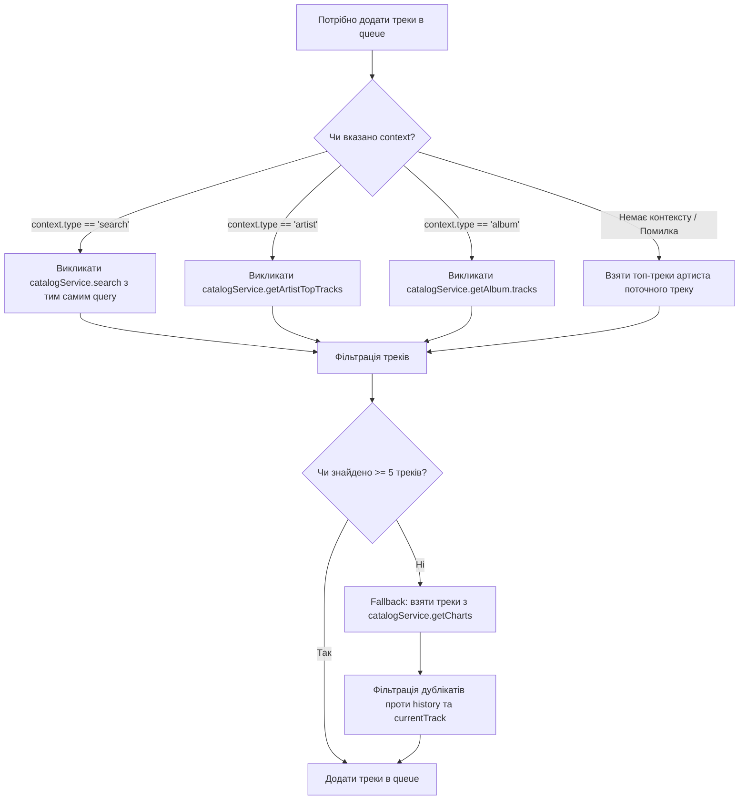

# Технічний дизайн: Задача 3 — Гнучкий бекенд-плеєр, історія та підбір черги, глобальний віджет аудіоплеєра та сторінка пошуку

**Гілка:** `tech-design-3`  
**Статус:** Чернетка для реалізації  
**Автор:** Sonora Engineering Team  
**Дата:** 2026-11-05  

---

## 1. Мета та контекст (Overview & Context)

### 1.1. Номер задачі та назва
- **Задача 3:** Розробка гнучкого бекенд-центричного аудіоплеєра з двосторонньою історією/чергою, примітивним алгоритмом добору наступних пісень, глобальним плаваючим віджетом плеєра на фронтенді (з винятками в лейауті профілю), реалізацією обраного (лайків) та сторінкою пошуку за готовим дизайном Sonora.

### 1.2. Посилання на ROADMAP.md
- [ROADMAP.md](../../ROADMAP.md):
  - **Розділ 26 (Catalog API):** Інтеграція з каталогом музики Deezer, ендпоінти `/api/catalog/search`, `/api/catalog/tracks/:id`, `/api/catalog/artists/:id/top-tracks`.
  - **Розділ 28 (Library):** Улюблені треки (`FavoriteTrack` / Liked tracks), ідемпотентні операції `like`/`unlike`.
  - **Розділ 29 (Listening History):** Фіксація прослуховувань:
    ```ts
    ListeningHistory { userId; trackId; startedAt; listenedSeconds; completed }
    ```
  - **Розділ 30 (Recommendation Engine):** Початкова логіка формування кандидатів черги.
  - **Розділ 31 (Player):**
    - Стан: `currentTrack`, `queue`, `history`, `isPlaying`, `currentTime`, `duration`, `volume`.
    - Функції: `play`, `pause`, `next`, `previous`, `seek`, `volume`, `repeat`, `shuffle`.
    - Життєвий цикл: `play` → `preview started` → `10 sec` → `25 sec` → `completed` → `replay / skip` → події в backend.
  - **Розділ 32–34 (Pages, Widgets, API Client):**
    - Сторінка `Search` (`apps/web/src/pages/app/search`).
    - Віджети `MusicPlayer` (`apps/web/src/widgets/music-player`), `TrackList`, `Queue`.
  - **Розділ 38 (Фази розробки):**
    - `Phase 11 — Frontend`: сторінка пошуку, інтеграція аудіо-віджетів.
    - `Phase 12 — Player`: аудіо-рушій, черга, play/pause, seek, volume, next/previous, listening events.

---

### 1.3. Опис бізнес-логіки та цілей

1. **Гнучкий бекенд-орієнтований плеєр (Backend-Centric Playback State):**
   - Фронтенд не володіє самостійно логікою черги та підбору треків. Фронтенд є точкою входу: користувач натискає на картку або рядок пісні, фронтенд передає команду на бекенд API (`POST /api/player/play`).
   - Бекенд зберігає та керує актуальним станом сесії користувача у **Redis** (`player:session:{userId}`), що забезпечує збереження стану при перезавантаженні сторінки, переході між роутами або зміні пристрою.
   - **Двосторонній рух (Bidirectional Queue & History):**
     - **Поточний трек (`currentTrack`):** пісня, що відтворюється в даний момент.
     - **Історія з початку плеєра (`history`):** стек треків, які вже прослухані користувачем з моменту запуску сесії. При виклику `previous` плеєр повертається до попередньої пісні зі стеку історії (або перезапускає поточну пісню, якщо вона відтворюється понад 3 секунди).
     - **Черга наступних пісень (`queue`):** список треків, запланованих для програвання вперед. При виклику `next` береться перший трек з черги, а поточний додається в історію.
2. **Примітивний алгоритм підбору наступних пісень (Primitive Queue Recommendation):**
   - Коли черга закінчується або трек запущено з контексту (наприклад, зі сторінки пошуку):
     - Якщо вказано контекст пошуку (`context.type === 'search'`): наступні треки беруться з результатів того ж пошукового запиту (`query`), виключаючи вже прослухані з `history` та `currentTrack`.
     - Якщо треки контексту вичерпані або контекст відсутній: алгоритм підтягує популярні треки того ж артиста (`catalogService.getArtistTopTracks(artistId)`).
     - Якщо й вони вичерпані: береться топ-вибірка з чартів Deezer (`catalogService.getCharts()`).
     - Результати фільтруються від дублікатів та додаються в `queue`.
3. **Глобальний віджет плеєра на фронтенді (`MusicPlayer.vue`):**
   - Віджет плаває над усіма сторінками додатку у фіксованому положенні знизу (`fixed bottom-0`).
   - Повний функціонал:
     - Запуск/зупинка (Play / Pause).
     - Перемотка назад (Previous / Replay) та вперед (Next).
     - Інтерактивна шкала прогресу з таймкодами (Seekable progress bar з повзунком).
     - Керування звуком: регулятор гучності (Volume slider) та швидке вимкнення (Mute/Unmute).
     - Додавання поточної пісні в обране (сердечко / Like).
4. **Винятки в лейауті (Layout Exclusions):**
   - Згідно з дизайном та вимогами, плеєр відображається на всіх основних сторінках додатку (Home, Search, Library, Albums, Artists, Settings тощо), **за винятком**:
     - Лейауту профайлу користувача (`/app/profile` або сторінки з класом `.profile-page`), де передбачено чистий естетичний екран без нижньої панелі плеєра.
     - Сторінки онбордингу (`/app/onboarding`).
     - Публічних сторінок (Landing, Login, Register, Forgot Password).
5. **Сторінка пошуку (`SearchPage.vue`):**
   - Реалізація за готовим еталонним дизайном із `music-streaming-design-8c9`:
     - Великий інпут пошуку (`.large-search`) з іконкою та автопошуком (debounce 300ms).
     - Категорії-фільтри (`.search-categories`: Tracks, Artists, Albums, Playlists).
     - Блок рекомендацій смаку (`.recommend-grid` з картками різних тонів: `art-coral`, `art-olive`, `art-blue`, `art-violet`).
     - Список знайдених треків (`.track-list` з рядками `.track-row`).
     - Клік на будь-яку картку чи рядок пісні слугує точкою входу — викликає API плеєра і починає відтворення.
6. **Обране (Favorites / Liked Tracks):**
   - Збереження лайкнутих треків у PostgreSQL (`FavoriteTrack`).
   - Статус `isLiked` синхронізований між бекендом, плеєром і списком треків на сторінці пошуку.
7. **Аналітика та історія (Listening History):**
   - Збереження записів у таблицю `ListeningHistory` при спрацьовуванні подій життєвого циклу треку (початок, 10 секунд, завершення, пропуск).

---

### 1.4. Scope (Межі робіт)

#### Що входить у задачу:
- **База даних (Prisma / PostgreSQL):**
  - Створення моделі `FavoriteTrack` (унікальність за `[userId, provider, providerId]`).
  - Створення моделі `ListeningHistory` з індексацією за користувачем та датою.
  - Генерація та виконання Prisma міграції.
- **Бекенд (`apps/api`):**
  - Модуль `PlayerModule` (`player.controller.ts`, `player.service.ts`, `player-queue.service.ts`).
  - Збереження сесії плеєра в Redis з TTL 7 днів.
  - Реалізація ендпоінтів:
    - `POST /api/player/play`
    - `POST /api/player/pause`
    - `POST /api/player/resume`
    - `POST /api/player/next`
    - `POST /api/player/previous`
    - `POST /api/player/seek`
    - `GET /api/player/state`
    - `POST /api/player/event`
  - Модуль `LibraryModule` (`library.controller.ts`, `library.service.ts`):
    - `POST /api/library/favorites/tracks/:id` (додати в обране)
    - `DELETE /api/library/favorites/tracks/:id` (видалити з обраного)
    - `GET /api/library/favorites/tracks/status` (перевірити статус лайка)
- **Спільні пакети (`packages/*`):**
  - `packages/shared-types`: типи плеєра (`PlayerState`, `PlayerContext`, `PlayTrackRequest`, `PlayerEventRequest`) та обраного (`FavoriteTrackSummary`, `FavoriteStatusResponse`).
  - `packages/api-client`: методи для простору імен `api.player.*` та `api.library.*`.
- **Фронтенд (`apps/web`):**
  - Pinia store `usePlayerStore` у `features/player/model/player.store.ts`: обгортка над HTML5 `Audio`, синхронізація з бекендом, реактивний стан.
  - `widgets/music-player/ui/MusicPlayer.vue`: точна верстка нижньої панелі `.player-bar` з готового дизайну `music-streaming-design-8c9`.
  - `pages/app/search/ui/SearchPage.vue`: повна верстка сторінки пошуку з `.large-search`, категоріями, рекомендаціями та списком результатів.
  - `entities/track/ui/TrackRow.vue`: універсальний рядок треку з підсвічуванням стану програвання (`is-playing`), кнопкою Play та кнопкою улюбленого.
  - `app/layouts/AppLayout.vue`: додавання плаваючого плеєра з винятком для сторінки профілю (`ROUTE_NAMES.profile`) та онбордингу, правильний відступ `padding-bottom: 90px`.

#### Non-Goals (що свідомо відкладається на наступні задачі):
- Повноцінний ML-алгоритм персональних рекомендацій (це окрема Phase 10 / Розділ 30).
- Керування користувацькими плейлистами (Phase 7 / Розділ 27).
- Стрімінг повних lossless аудіо-файлів (використовуються 30-секундні прев'ю Deezer відповідно до канонічного каталогу).
- Офлайн-кешування аудіо (PWA service worker audio cache).

---

## 2. Зміни в базі даних (Database / Prisma / PostgreSQL)

### 2.1. Оновлення схеми `apps/api/prisma/schema.prisma`

Додаємо дві нові моделі: `FavoriteTrack` для обраного користувача та `ListeningHistory` для аудиту прослуховувань:

```prisma
// ==========================================
// LIBRARY & FAVORITES
// ==========================================

model FavoriteTrack {
  id         String        @id @default(uuid())
  userId     String        @map("user_id")
  provider   MusicProvider @default(DEEZER)
  providerId String        @map("provider_id")
  title      String
  artistName String        @map("artist_name")
  albumTitle String?       @map("album_title")
  coverUrl   String?       @map("cover_url")
  duration   Int
  previewUrl String?       @map("preview_url")
  createdAt  DateTime      @default(now()) @map("created_at")

  user User @relation(fields: [userId], references: [id], onDelete: Cascade)

  @@unique([userId, provider, providerId])
  @@index([userId, createdAt(sort: Desc)])
  @@map("favorite_tracks")
}

// ==========================================
// LISTENING HISTORY & ANALYTICS
// ==========================================

model ListeningHistory {
  id              String        @id @default(uuid())
  userId          String        @map("user_id")
  provider        MusicProvider @default(DEEZER)
  providerId      String        @map("provider_id")
  trackTitle      String        @map("track_title")
  artistName      String        @map("artist_name")
  albumTitle      String?       @map("album_title")
  coverUrl        String?       @map("cover_url")
  startedAt       DateTime      @default(now()) @map("started_at")
  listenedSeconds Int           @default(0) @map("listened_seconds")
  completed       Boolean       @default(false)

  user User @relation(fields: [userId], references: [id], onDelete: Cascade)

  @@index([userId, startedAt(sort: Desc)])
  @@map("listening_histories")
}
```

Також оновлюємо модель `User` у `schema.prisma`, додавши зворотні зв'язки:

```prisma
model User {
  // ... існуючі поля
  favorites FavoriteTrack[]
  history   ListeningHistory[]

  @@map("users")
}
```

### 2.2. План міграції бази даних

```bash
# 1. Генерація та застосування міграції
pnpm --filter @music-app/api prisma:migrate:dev --name add_favorite_tracks_and_listening_history

# 2. Оновлення типів Prisma клієнта
pnpm --filter @music-app/api prisma:generate
```

---

## 3. Бекенд реалізація (`apps/api`)

### 3.1. Модульна структура

```text
apps/api/src/modules/
├── player/
│   ├── dto/
│   │   ├── play-track.dto.ts
│   │   ├── seek-track.dto.ts
│   │   └── player-event.dto.ts
│   ├── player.controller.ts
│   ├── player.service.ts
│   ├── player-queue.service.ts
│   ├── player.types.ts
│   ├── player.module.ts
│   └── player.service.spec.ts
└── library/
    ├── dto/
    │   └── favorite-status-query.dto.ts
    ├── library.controller.ts
    ├── library.service.ts
    ├── library.module.ts
    └── library.service.spec.ts
```

---

### 3.2. Стан сесії плеєра в Redis (`player.types.ts`)

Ключ у Redis: `player:session:{userId}`.  
Час життя (TTL): 7 днів (`604800` секунд), продовжується при кожному зверненні.

```ts
import type { TrackSummary } from '@music-app/shared-types'

export interface PlayerContextDto {
  type: 'search' | 'artist' | 'album' | 'playlist'
  id?: string
  query?: string
}

export interface PlayerSessionState {
  userId: string
  currentTrack: TrackSummary | null
  isPlaying: boolean
  progressMs: number
  volume: number // 0-100
  updatedAt: number // epoch ms
  history: TrackSummary[] // стек прослуханих треків (від найновішого до старішого)
  queue: TrackSummary[]   // черга майбутніх треків (перший на черзі: queue[0])
  context?: PlayerContextDto
  isLiked?: boolean
}
```

---

### 3.3. Примітивний алгоритм підбору наступних пісень (`player-queue.service.ts`)

Сервіс `PlayerQueueService` реалізує примітивний, але надійний детермінований алгоритм добору пісень:



#### Правила фільтрації кандидатів:
1. Виключаються ID треків, що вже є в `history` поточної сесії.
2. Виключається `currentTrack.providerId`.
3. Виключаються ID, що вже чекають у `queue`.
4. Вибирається порція від 5 до 10 треків.

---

### 3.4. Логіка двостороннього перемикання (`player.service.ts`)

1. **`play(userId, { trackId, context })`**:
   - Отримує повні дані про трек з `CatalogService.getTrack(trackId)`.
   - Якщо в сесії вже був `currentTrack`, переміщує його у вершину `history`.
   - Встановлює `currentTrack = track`, `isPlaying = true`, `progressMs = 0`.
   - Зберігає `context`.
   - Викликає `PlayerQueueService.populateQueue(...)` для наповнення `queue`.
   - Перевіряє, чи доданий цей трек в `FavoriteTrack` для даного користувача, і встановлює `isLiked`.
   - Зберігає сесію в Redis.
2. **`next(userId)`**:
   - Якщо `currentTrack` існує: записує подію в `ListeningHistory`, переміщує `currentTrack` у `history`.
   - Якщо `queue` порожня або в ній менше 2 треків: викликає автопідбір наступних треків.
   - Бере перший трек з черги: `const nextTrack = queue.shift()`.
   - Встановлює `currentTrack = nextTrack`, `isPlaying = true`, `progressMs = 0`.
   - Зберігає стан у Redis і повертає оновлений стан.
3. **`previous(userId)`**:
   - Перевіряє `progressMs`:
     - Якщо відтворення триває понад 3 секунди (3000 мс) — повторює поточний трек з початку (`progressMs = 0`), не перемикаючи пісню (класичний стандарт UX медіаплеєрів Spotify/Apple Music).
     - Якщо відтворення менше 3 секунд і `history.length > 0`:
       - Поточний `currentTrack` повертається на початок черги `queue.unshift(currentTrack)`.
       - З історії витягується останній трек: `currentTrack = history.pop()`.
       - `progressMs = 0`, `isPlaying = true`.
   - Зберігає стан у Redis і повертає оновлений стан.
4. **`pause(userId)`** / **`resume(userId)`** / **`seek(userId, positionSec)`**:
   - Оновлюють прапорець `isPlaying` та `progressMs`, зберігають у Redis.

---

### 3.5. REST API Ендпоінти

Всі ендпоінти захищені `JwtAuthGuard`, користувач береться з `@CurrentUser()`.

#### Плеєр (`apps/api/src/modules/player/player.controller.ts`)

| Метод | Шлях | Опис | Тіло запиту / Параметри | Статус |
| :--- | :--- | :--- | :--- | :--- |
| `GET` | `/api/player/state` | Отримати стан сесії плеєра | — | `200 OK` |
| `POST` | `/api/player/play` | Запустити трек | `{ trackId: string, context?: PlayerContextDto }` | `200 OK` |
| `POST` | `/api/player/pause` | Поставити на паузу | — | `200 OK` |
| `POST` | `/api/player/resume` | Продовжити відтворення | — | `200 OK` |
| `POST` | `/api/player/next` | Наступний трек (з автопідбором) | — | `200 OK` |
| `POST` | `/api/player/previous`| Попередній трек (з історії) | — | `200 OK` |
| `POST` | `/api/player/seek` | Змінити позицію відтворення | `{ positionSec: number }` | `200 OK` |
| `POST` | `/api/player/event` | Подія життєвого циклу треку | `{ trackId: string, event: 'started'\|'listened_10s'\|'completed'\|'skipped', durationSec: number }` | `200 OK` |

#### Бібліотека та Обране (`apps/api/src/modules/library/library.controller.ts`)

| Метод | Шлях | Опис | Тіло запиту / Параметри | Статус |
| :--- | :--- | :--- | :--- | :--- |
| `POST` | `/api/library/favorites/tracks/:id` | Додати трек в обране | — | `201 Created` |
| `DELETE` | `/api/library/favorites/tracks/:id` | Видалити трек з обраного | — | `200 OK` |
| `GET` | `/api/library/favorites/tracks/status` | Перевірити статус лайків для списку ID | `?ids=123,456,789` | `200 OK` |
| `GET` | `/api/library/favorites/tracks` | Отримати список улюблених треків | `?limit=50&offset=0` | `200 OK` |

---

### 3.6. Валідація DTO (`class-validator`)

```ts
// apps/api/src/modules/player/dto/play-track.dto.ts
import { IsNotEmpty, IsOptional, IsString, ValidateNested } from 'class-validator'
import { Type } from 'class-transformer'
import { ApiProperty, ApiPropertyOptional } from '@nestjs/swagger'

export class PlayerContextDto {
  @ApiProperty({ enum: ['search', 'artist', 'album', 'playlist'] })
  @IsString()
  @IsNotEmpty()
  type!: 'search' | 'artist' | 'album' | 'playlist'

  @ApiPropertyOptional()
  @IsString()
  @IsOptional()
  id?: string

  @ApiPropertyOptional()
  @IsString()
  @IsOptional()
  query?: string
}

export class PlayTrackDto {
  @ApiProperty({ description: 'ID треку з Deezer' })
  @IsString()
  @IsNotEmpty()
  trackId!: string

  @ApiPropertyOptional({ type: PlayerContextDto })
  @IsOptional()
  @ValidateNested()
  @Type(() => PlayerContextDto)
  context?: PlayerContextDto
}
```

---

## 4. Фронтенд реалізація (`apps/web`)

### 4.1. FSD Архітектура

```text
apps/web/src/
├── entities/
│   └── track/
│       ├── ui/
│       │   ├── TrackRow.vue      # Рядок треку для списків і результатів пошуку
│       │   └── TrackCard.vue     # Картка для сіток рекомендацій
│       └── index.ts
├── features/
│   ├── player/
│   │   ├── model/
│   │   │   ├── player.store.ts   # Pinia store + HTMLAudioElement керування
│   │   │   └── use-player.ts     # Composable для компонентів
│   │   └── index.ts
│   └── library/
│       └── model/
│           └── use-favorite-track.mutation.ts # Мутація лайку/дизлайку
├── widgets/
│   └── music-player/
│       ├── ui/
│       │   ├── MusicPlayer.vue   # Нижня закріплена планка плеєра (.player-bar)
│       │   ├── PlayerTrack.vue   # Лівий блок: обкладинка, назва, сердечко
│       │   ├── PlayerControls.vue# Центр: кнопки, прогрес-бар
│       │   └── PlayerVolume.vue  # Правий блок: час, регулятор звуку
│       └── index.ts
├── pages/
│   └── app/
│       └── search/
│           └── ui/
│               └── SearchPage.vue# Сторінка пошуку за еталонним дизайном
└── app/
    └── layouts/
        └── AppLayout.vue         # Глобальне розміщення віджета плеєра над усіма сторінками
```

---

### 4.2. Керування аудіо та Pinia Store (`player.store.ts`)

Ключовий елемент — реактивний стор `usePlayerStore`, який тримає інстанс `HTMLAudioElement` в пам'яті браузера і надсилає команди на бекенд:

```ts
import { defineStore } from 'pinia'
import { ref, computed } from 'vue'
import type { TrackSummary, PlayerState, PlayerContext } from '@music-app/shared-types'
import { api } from '@/shared/api/client'

export const usePlayerStore = defineStore('player', () => {
  const audio = new Audio()
  
  // Реактивний стан
  const currentTrack = ref<TrackSummary | null>(null)
  const isPlaying = ref(false)
  const currentTime = ref(0)
  const duration = ref(30) // Прев'ю триває 30 секунд
  const volume = ref(70)   // 0 - 100
  const isMuted = ref(false)
  const isLiked = ref(false)
  const history = ref<TrackSummary[]>([])
  const queue = ref<TrackSummary[]>([])
  const context = ref<PlayerContext | null>(null)
  const isBuffering = ref(false)

  // Ініціалізація аудіо слухачів
  audio.addEventListener('timeupdate', () => {
    currentTime.value = audio.currentTime
    // Відправка аналітичних подій на 10-й секунді
    checkPlaybackMilestones(audio.currentTime)
  })

  audio.addEventListener('ended', () => {
    // Коли прев'ю добігло кінця — викликаємо наступний трек через бекенд
    api.player.emitEvent({ trackId: currentTrack.value?.providerId!, event: 'completed', durationSec: 30 })
    next()
  })

  audio.addEventListener('play', () => { isPlaying.value = true })
  audio.addEventListener('pause', () => { isPlaying.value = false })
  audio.addEventListener('waiting', () => { isBuffering.value = true })
  audio.addEventListener('playing', () => { isBuffering.value = false })

  // Дії (Actions)
  async function playTrack(track: TrackSummary, ctx?: PlayerContext) {
    if (!track.previewUrl) return

    // Виклик бекенду для синхронізації черги та історії
    const res = await api.player.play({ trackId: track.providerId, context: ctx })
    applyServerState(res)

    audio.src = track.previewUrl
    audio.volume = isMuted.value ? 0 : volume.value / 100
    await audio.play()
  }

  async function togglePlay() {
    if (!currentTrack.value) return
    if (isPlaying.value) {
      audio.pause()
      await api.player.pause()
    } else {
      await audio.play()
      await api.player.resume()
    }
  }

  async function next() {
    const res = await api.player.next()
    applyServerState(res)
    if (res.currentTrack?.previewUrl) {
      audio.src = res.currentTrack.previewUrl
      await audio.play()
    }
  }

  async function previous() {
    if (audio.currentTime > 3) {
      audio.currentTime = 0
      currentTime.value = 0
      await api.player.seek({ positionSec: 0 })
      return
    }
    const res = await api.player.previous()
    applyServerState(res)
    if (res.currentTrack?.previewUrl) {
      audio.src = res.currentTrack.previewUrl
      await audio.play()
    }
  }

  function seek(seconds: number) {
    audio.currentTime = seconds
    currentTime.value = seconds
    api.player.seek({ positionSec: Math.floor(seconds) })
  }

  function setVolume(val: number) {
    volume.value = Math.max(0, Math.min(100, val))
    isMuted.value = false
    audio.volume = volume.value / 100
  }

  function toggleMute() {
    isMuted.value = !isMuted.value
    audio.volume = isMuted.value ? 0 : volume.value / 100
  }

  async function toggleLike() {
    if (!currentTrack.value) return
    const id = currentTrack.value.providerId
    if (isLiked.value) {
      await api.library.removeFavoriteTrack(id)
      isLiked.value = false
    } else {
      await api.library.addFavoriteTrack(id)
      isLiked.value = true
    }
  }

  function applyServerState(state: PlayerState) {
    currentTrack.value = state.currentTrack
    history.value = state.history
    queue.value = state.queue
    context.value = state.context ?? null
    isLiked.value = !!state.isLiked
  }

  return {
    currentTrack,
    isPlaying,
    currentTime,
    duration,
    volume,
    isMuted,
    isLiked,
    history,
    queue,
    playTrack,
    togglePlay,
    next,
    previous,
    seek,
    setVolume,
    toggleMute,
    toggleLike,
  }
})
```

---

### 4.3. Візуальний компонент `MusicPlayer.vue`

Повністю відтворює CSS та розмітку з еталонного проекту (`music-streaming-design-8c9`):

```html
<footer class="player-bar" v-if="playerStore.currentTrack">
  <!-- 1. Інформація про трек + Лайк -->
  <div class="player-track">
    <div class="artwork art-rust size-11 rounded-xl">
      
    </div>
    <div class="track-info">
      <strong>{{ playerStore.currentTrack.title }}</strong>
      <span>{{ playerStore.currentTrack.artist.name }}</span>
    </div>
    <button
      class="player-heart"
      :class="{ 'is-liked': playerStore.isLiked }"
      aria-label="Favorite track"
      type="button"
      @click="playerStore.toggleLike"
    >
      <IconHeart :size="17" :fill="playerStore.isLiked ? 'currentColor' : 'none'" />
    </button>
  </div>

  <!-- 2. Кнопки керування + Прогрес -->
  <div class="player-controls">
    <div class="control-buttons">
      <button aria-label="Previous" type="button" @click="playerStore.previous">
        <IconPlayerTrackPrevFilled :size="16" />
      </button>
      <button
        class="main-play"
        :aria-label="playerStore.isPlaying ? 'Pause' : 'Play'"
        type="button"
        @click="playerStore.togglePlay"
      >
        <IconPlayerPauseFilled v-if="playerStore.isPlaying" :size="16" />
        <IconPlayerPlayFilled v-else :size="16" />
      </button>
      <button aria-label="Next" type="button" @click="playerStore.next">
        <IconPlayerTrackNextFilled :size="16" />
      </button>
    </div>

    <!-- Інтерактивний Seekbar -->
    <div class="progress-line" @click="onSeekClick">
      <span :style="{ width: `${progressPercent}%` }"></span>
      <i :style="{ left: `${progressPercent}%` }"></i>
    </div>
  </div>

  <!-- 3. Дії: Таймкод + Звук -->
  <div class="player-actions">
    <span>{{ formatTime(playerStore.currentTime) }} / 0:30</span>
    <button class="volume-btn" @click="playerStore.toggleMute">
      <IconVolume3 v-if="playerStore.volume > 50 && !playerStore.isMuted" :size="18" />
      <IconVolume2 v-else-if="playerStore.volume > 0 && !playerStore.isMuted" :size="18" />
      <IconVolume v-else :size="18" />
    </button>
    <div class="volume-line" @click="onVolumeClick">
      <span :style="{ width: `${playerStore.isMuted ? 0 : playerStore.volume}%` }"></span>
    </div>
  </div>
</footer>
```

---

### 4.4. Сторінка пошуку (`SearchPage.vue`)

Повністю використовує верстку з файлів `music-streaming-design-8c9/app/routes/$page.tsx` та `global.css`:

```html
<section class="content-wrap section-page">
  <p class="eyebrow accent-text">Explore</p>
  <h1>Search the sound</h1>

  <div class="search-screen">
    <!-- Великий рядок пошуку -->
    <div class="large-search">
      <IconSearch :size="20" />
      <input
        v-model="searchQuery"
        autoFocus
        placeholder="What do you want to listen to?"
        aria-label="Search for music"
      />
    </div>

    <!-- Категорії -->
    <div class="search-categories">
      <span :class="{ 'is-active': activeCategory === 'tracks' }" @click="activeCategory = 'tracks'">Tracks</span>
      <span :class="{ 'is-active': activeCategory === 'artists' }" @click="activeCategory = 'artists'">Artists</span>
      <span :class="{ 'is-active': activeCategory === 'albums' }" @click="activeCategory = 'albums'">Albums</span>
      <span :class="{ 'is-active': activeCategory === 'playlists' }" @click="activeCategory = 'playlists'">Playlists</span>
    </div>

    <!-- Стан результатів пошуку -->
    <div v-if="searchResults?.tracks?.items?.length" class="search-results-block">
      <div class="section-heading">
        <h3>Tracks</h3>
        <span>Found {{ searchResults.tracks.pagination.total }} results</span>
      </div>

      <div class="track-list">
        <TrackRow
          v-for="(track, index) in searchResults.tracks.items"
          :key="track.providerId"
          :track="track"
          :index="index + 1"
          :is-playing="playerStore.currentTrack?.providerId === track.providerId && playerStore.isPlaying"
          @play="playerStore.playTrack(track, { type: 'search', query: searchQuery })"
        />
      </div>
    </div>

    <!-- Блок рекомендацій (коли рядок пошуку порожній) -->
    <div v-else-if="!searchQuery.trim()" class="search-recommend-block">
      <div class="section-heading">
        <h3>Browse your taste</h3>
        <button type="button">Recommended <IconChevronRight :size="15" /></button>
      </div>

      <div class="recommend-grid">
        <div
          v-for="(card, i) in tasteCards"
          :key="card.title"
          class="recommend-card cursor-pointer"
          @click="onTasteCardClick(card)"
        >
          <div class="art-wrap">
            <div :class="`artwork aspect-square rounded-[18px] ${card.tone}`">
              <span class="artwork-shape"></span>
              <span class="artwork-shape artwork-shape-two"></span>
            </div>
            <span class="card-play"><IconPlayerPlayFilled :size="14" /></span>
          </div>
          <strong>{{ card.title }}</strong>
          <span>{{ card.subtitle }}</span>
        </div>
      </div>
    </div>
  </div>
</section>
```

---

### 4.5. Інтеграція в Лейаути та Винятки (`AppLayout.vue`)

У `AppLayout.vue` перевіряємо, щоб плеєр не відображався в профілі (`route.name === ROUTE_NAMES.profile`):

```vue
<script setup lang="ts">
import { computed } from 'vue'
import { RouterView, useRoute } from 'vue-router'
import { AppHeader } from '@/widgets/app-header'
import { AppSidebar } from '@/widgets/app-sidebar'
import { MusicPlayer } from '@/widgets/music-player'
import { ROUTE_NAMES } from '@/app/router/routes'
import { usePlayerStore } from '@/features/player'

const route = useRoute()
const playerStore = usePlayerStore()

const isOnboarding = computed(() => route.name === ROUTE_NAMES.onboarding)
const isProfile = computed(() => route.name === 'profile' || route.path.endsWith('/profile'))

// Плеєр вимикається для онбордингу та профілю
const shouldShowPlayer = computed(() => !isOnboarding.value && !isProfile.value && !!playerStore.currentTrack)
</script>

<template>
  <div class="app-layout" :class="{ 'app-layout--onboarding': isOnboarding }">
    <template v-if="!isOnboarding">
      <AppSidebar class="app-layout__sidebar" />

      <div class="app-layout__main">
        <AppHeader />
        <main class="app-layout__content" :class="{ 'has-player-padding': shouldShowPlayer }">
          <RouterView />
        </main>
      </div>

      <MusicPlayer v-if="shouldShowPlayer" class="app-layout__player" />
    </template>

    <main v-else class="app-layout__onboarding">
      <RouterView />
    </main>
  </div>
</template>

<style scoped>
.has-player-padding {
  padding-bottom: 90px !important;
}
</style>
```

---

## 5. Спільні контракти (`packages/*`)

### 5.1. `packages/shared-types`

Створюємо нові файли `player.ts` та `library.ts`:

```ts
// packages/shared-types/src/player.ts
import type { TrackSummary } from './catalog.js'

export interface PlayerContext {
  type: 'search' | 'artist' | 'album' | 'playlist'
  id?: string
  query?: string
}

export interface PlayerState {
  userId: string
  currentTrack: TrackSummary | null
  isPlaying: boolean
  progressMs: number
  volume: number
  updatedAt: number
  history: TrackSummary[]
  queue: TrackSummary[]
  context?: PlayerContext
  isLiked?: boolean
}

export interface PlayTrackRequest {
  trackId: string
  context?: PlayerContext
}

export interface SeekTrackRequest {
  positionSec: number
}

export interface PlayerEventRequest {
  trackId: string
  event: 'started' | 'listened_10s' | 'completed' | 'skipped'
  durationSec: number
}
```

```ts
// packages/shared-types/src/library.ts
import type { MusicProvider } from './provider.js'

export interface FavoriteTrackSummary {
  id: string
  provider: MusicProvider
  providerId: string
  title: string
  artistName: string
  albumTitle: string | null
  coverUrl: string | null
  duration: number
  previewUrl: string | null
  createdAt: string
}

export interface FavoriteStatusResponse {
  [trackProviderId: string]: boolean
}
```

Експортуємо їх у `packages/shared-types/src/index.ts`.

---

### 5.2. `packages/api-client`

Розширюємо API клієнт методами `player` та `library`:

```ts
// packages/api-client/src/client.ts
player: {
  getState: () => http.get<PlayerState>('/player/state'),
  play: (body: PlayTrackRequest) => http.post<PlayerState>('/player/play', { body }),
  pause: () => http.post<PlayerState>('/player/pause'),
  resume: () => http.post<PlayerState>('/player/resume'),
  next: () => http.post<PlayerState>('/player/next'),
  previous: () => http.post<PlayerState>('/player/previous'),
  seek: (body: SeekTrackRequest) => http.post<PlayerState>('/player/seek', { body }),
  emitEvent: (body: PlayerEventRequest) => http.post<{ success: boolean }>('/player/event', { body }),
},
library: {
  addFavoriteTrack: (id: string) => http.post<{ success: boolean }>(`/library/favorites/tracks/${encodeURIComponent(id)}`),
  removeFavoriteTrack: (id: string) => http.delete<{ success: boolean }>(`/library/favorites/tracks/${encodeURIComponent(id)}`),
  getFavoriteStatus: (ids: string[]) =>
    http.get<FavoriteStatusResponse>('/library/favorites/tracks/status', {
      query: { ids: ids.join(',') },
    }),
  getFavorites: (params?: { limit?: number; offset?: number }) =>
    http.get<Paginated<FavoriteTrackSummary>>('/library/favorites/tracks', { query: params }),
}
```

---

## 6. Покроковий план впровадження (Implementation Tasks)

- [ ] **Крок 1: База даних (Prisma & PostgreSQL)**
  - [ ] Додати моделі `FavoriteTrack` та `ListeningHistory` у `apps/api/prisma/schema.prisma`.
  - [ ] Оновити зв'язки в моделі `User`.
  - [ ] Запустити команду міграції `pnpm --filter @music-app/api prisma:migrate:dev --name add_favorite_tracks_and_listening_history`.
  - [ ] Згенерувати клієнт `pnpm --filter @music-app/api prisma:generate`.

- [ ] **Крок 2: Спільні типи та контракти (`packages/*`)**
  - [ ] Створити `packages/shared-types/src/player.ts` та `packages/shared-types/src/library.ts`.
  - [ ] Експортувати нові контракти у `packages/shared-types/src/index.ts`.
  - [ ] Додати методи `player` та `library` у `packages/api-client/src/client.ts`.
  - [ ] Зібрати пакети: `pnpm --filter @music-app/shared-types build` та `pnpm --filter @music-app/api-client build`.

- [ ] **Крок 3: Бекенд реалізація (`apps/api`)**
  - [ ] Створити модуль `PlayerModule`:
    - [ ] `PlayerQueueService`: примітивний алгоритм підбору наступних пісень на основі контексту (search, artist, chart) та фільтрації дублікатів.
    - [ ] `PlayerService`: управління станом плеєра у Redis (`player:session:{userId}`), команди `play`, `pause`, `resume`, `next`, `previous`, `seek`.
    - [ ] `PlayerController`: REST ендпоінти плеєра з декораторами Swagger та JwtAuthGuard.
  - [ ] Створити модуль `LibraryModule`:
    - [ ] `LibraryService`: додавання/видалення з обраного в PostgreSQL, перевірка статусу.
    - [ ] `LibraryController`: ендпоінти улюблених треків.
  - [ ] Підключити `PlayerModule` та `LibraryModule` у `AppModule`.
  - [ ] Написати юніт-тести для `PlayerService` та `PlayerQueueService`.

- [ ] **Крок 4: Фронтенд сутності та стан (`apps/web`)**
  - [ ] Створити Pinia store `usePlayerStore` (`features/player/model/player.store.ts`):
    - [ ] Керування об'єктом `new Audio()`.
    - [ ] Обробка подій звуку (`ended`, `timeupdate`, `play`, `pause`, `error`).
    - [ ] Синхронізація з методами API `api.player.*` та `api.library.*`.
  - [ ] Створити компонент `TrackRow.vue` у `entities/track/ui/`:
    - [ ] Стилізація за CSS класом `.track-row` з підтримкою ховеру та `.is-playing`.
    - [ ] Відображення номера / кнопки play, обкладинки, назви, артиста, альбому, часу.
    - [ ] Клік на рядок запускає відтворення.

- [ ] **Крок 5: Віджет плеєра (`widgets/music-player`)**
  - [ ] Оновити `MusicPlayer.vue` за еталонною версткою з `music-streaming-design-8c9`:
    - [ ] Лівий блок: обкладинка, назва треку, виконавець, кнопка-сердечко (`.player-heart`).
    - [ ] Центральний блок: кнопка попереднього треку, кругла кнопка play/pause (`.main-play`), кнопка наступного треку, прогрес-бар (`.progress-line`) з перемоткою за кліком.
    - [ ] Правий блок: поточний час (`1:42`), іконка гучності, повзунок гучності (`.volume-line`).
  - [ ] Перевірити адаптивність для мобільних екранів (`@media (max-width: 640px)`).

- [ ] **Крок 6: Сторінка пошуку (`pages/app/search`)**
  - [ ] Оновити `SearchPage.vue` згідно з еталонним дизайном:
    - [ ] Поле вводу `.large-search` з дебаунсом 300мс.
    - [ ] Категорії `.search-categories`.
    - [ ] Рекомендації смаку `.recommend-grid` з кольоровими картками.
    - [ ] Список знайдених треків `.track-list` з інтеграцією кліку в плеєр.

- [ ] **Крок 7: Лейаути та інтеграція (`AppLayout.vue`)**
  - [ ] Підключити віджет `<MusicPlayer>` у `AppLayout.vue` для всіх сторінок додатку.
  - [ ] Налаштувати приховування плеєра для сторінок профілю (`route.name === ROUTE_NAMES.profile`) та онбордингу.
  - [ ] Додати захисний відступ знизу (`padding-bottom: 90px`) для основного контенту, щоб плеєр не перекривав інтерфейс.

- [ ] **Крок 8: Тестування та перевірка якості**
  - [ ] Перевірити збірку всіх пакетів: `pnpm build`.
  - [ ] Запустити лінтер: `pnpm lint`.
  - [ ] Запустити бекенд та фронтенд тести: `pnpm test`.

---

## 7. Definition of Done (Критерії готовності)

1. [ ] **База даних:** Моделі `FavoriteTrack` та `ListeningHistory` успішно мігровані в PostgreSQL, Prisma Client згенеровано.
2. [ ] **Бекенд API:**
   - [ ] Ендпоінти плеєра (`/api/player/*`) коректно повертають стан, обробляють паузу, продовження, зміну позиції.
   - [ ] Перемикання треків працює в обидва боки: `next` дістає трек з черги, `previous` повертає трек з історії або перезапускає поточний трек (> 3 сек).
   - [ ] Примітивний алгоритм підбору треків наповнює `queue` треками з результатів пошуку, треками артиста або чартами Deezer, без дублювання.
   - [ ] Працюють ендпоінти додавання/видалення з обраного (`/api/library/favorites/tracks/*`).
3. [ ] **Фронтенд сторінка пошуку:**
   - [ ] Дизайн повністю відповідає макету з `music-streaming-design-8c9`.
   - [ ] Клік на пісню в результатах пошуку або на рекомендаційну картку починає відтворення треку в плеєрі.
   - [ ] Активний трек підсвічується класом `.is-playing`.
4. [ ] **Фронтенд плеєр:**
   - [ ] Закріплений внизу екрана над усіма сторінками додатку.
   - [ ] Не показується на сторінці профілю та онбордингу.
   - [ ] Можна ставити на паузу, перемотувати, регулювати гучність, додавати в обране.
5. [ ] **Кодова база:** Лінтери (`pnpm lint`) та збірка (`pnpm build`) проходять без помилок та попереджень.
