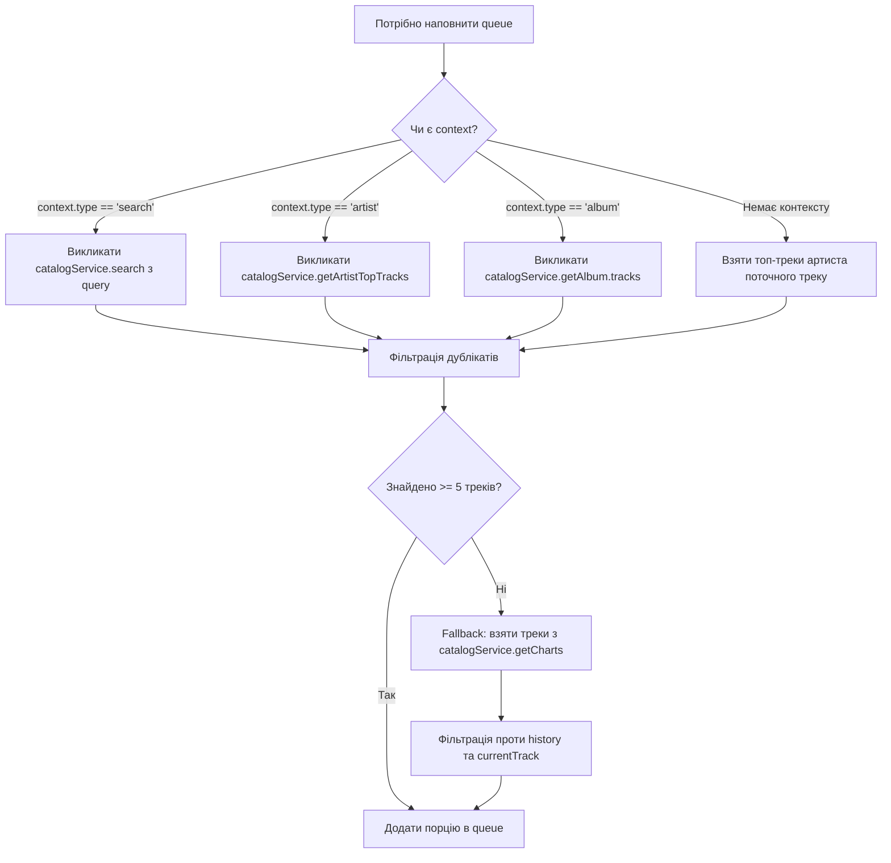

# Технічний дизайн: Задача 9 — Гнучкий бекенд-плеєр, історія та підбір черги, глобальний віджет аудіоплеєра та інтеграція точок входу

**Гілка:** `tech-design-9`  
**Статус:** Чернетка для реалізації  
**Автор:** Sonora Engineering Team  
**Дата:** 2026-11-18  

---

## 1. Мета та контекст (Overview & Context)

### 1.1. Номер задачі та назва
- **Задача 9:** Розробка гнучкого бекенд-центричного аудіоплеєра з двосторонньою чергою/історією, примітивним алгоритмом добору наступних пісень, інтеграцією точок входу (клік на пісню в пошуку та на головній), глобальним плаваючим віджетом плеєра (з винятком для сторінки профілю) та збереженням улюблених треків (обране/лайки).

### 1.2. Посилання на ROADMAP.md
- [ROADMAP.md](../../ROADMAP.md):
  - **Розділ 26 (Catalog API):** Отримання метаданих треків, прев'ю, топ-треків артистів (`/api/catalog/tracks/:id`, `/api/catalog/artists/:id/top-tracks`).
  - **Розділ 28 (Library):** Улюблені треки (`FavoriteTrack` / Liked tracks), ідемпотентні операції `like`/`unlike`.
  - **Розділ 29 (Listening History):** Фіксація прослуховувань:
    ```ts
    ListeningHistory { userId; trackId; startedAt; listenedSeconds; completed }
    ```
  - **Розділ 30 (Recommendation Engine):** Джерело кандидатів для черги майбутніх треків.
  - **Розділ 31 (Player):**
    - Стан: `currentTrack`, `queue`, `history`, `isPlaying`, `currentTime`, `duration`, `volume`.
    - Функції: `play`, `pause`, `next`, `previous`, `seek`, `volume`, `repeat`, `shuffle`.
    - Життєвий цикл: `play` → `preview started` → `10 sec` → `25 sec` → `completed` → `replay / skip` → події в backend.
  - **Розділ 32–34 (Pages, Widgets, API Client):**
    - Віджети `MusicPlayer` (`apps/web/src/widgets/music-player`), `TrackRow` (`apps/web/src/entities/track`).
  - **Розділ 38 (Фази розробки):**
    - `Phase 9 — Listening History`: події `play`, `skip`, фіксація тривалості, збереження в БД.
    - `Phase 12 — Player`: аудіо-рушій на фронтенді, синхронізація з бекендом, керування чергою.

---

### 1.3. Поточний стан проекту після Задач 3 та 4

Перед стартом цієї задачі в проекті було реалізовано:
1. **Задача 3:** Головна сторінка (`HomePage.vue`), колекція щотижневих рекомендацій (`RecommendationsModule` на бекенді, таблиця `recommendation_collections`).
2. **Задача 4:** Сторінка пошуку (`SearchPage.vue`), таби категорій (`All`, `Tracks`, `Artists`, `Albums`), віджет `SearchResults.vue`, компоненти `TrackRow`, `ArtistCard`, `AlbumCard`. У `AppLayout.vue` було розміщено візуальний макет `MusicPlayer.vue`.

**Що зараз відсутнє і є метою Задачі 9:**
- `MusicPlayer.vue` є суто статичним макетом із захардкодженними рядками (`"My Own Summer"`, `"Deftones"`). Немає справжнього аудіо-рушія (`new Audio()`), немає зв'язку з бекендом.
- `TrackRow.vue` у списку пошуку та на головній є пасивним div: клік по ньому нічого не робить, відтворення не запускається, немає ховер-іконки Play та індикатора `.is-playing`.
- На бекенді відсутній `PlayerModule` та збереження сесії користувача в Redis.
- Відсутній механізм черги (`queue`) та історії прослуханого (`history`) з двостороннім рухом (`next`/`previous`).
- Відсутня можливість зберегти пісню в обране (кнопка-сердечко нічого не зберігає).
- У `AppLayout.vue` плеєр відображається завжди, включно зі сторінкою профілю, де за дизайном його має не бути.

---

### 1.4. Опис бізнес-логіки та архітектурних вимог

1. **Бекенд-орієнтований плеєр (Backend-Driven State):**
   - Фронтенд містить лише точки входу: користувач натискає на пісню в пошуку або на рекомендацію, фронтенд викликає `POST /api/player/play` з ID треку та контекстом.
   - Бекенд зберігає актуальний стан сесії користувача в **Redis** за ключем `player:session:{userId}` (TTL 7 днів).
   - **Двосторонній рух (Bidirectional Playback):**
     - **Поточний трек (`currentTrack`):** пісня, яка грає прямо зараз.
     - **Історія з початку сесії (`history`):** стек треків, прослуханих користувачем. При виклику `previous`:
       - Якщо трек грав більше 3 секунд — поточний трек перезапускається з 0:00 (стандарт UX).
       - Якщо трек грав менше 3 секунд — з `history` дістається попередній трек, а поточний повертається в початок `queue`.
     - **Черга наступних пісень (`queue`):** список треків наперед. При виклику `next` перший трек дістається з черги, а поточний додається в `history`.
2. **Примітивний алгоритм підбору наступних пісень (`PlayerQueueService`):**
   - Коли черга закінчується або трек запущено з контексту (наприклад, з пошуку):
     - **Контекстний добір:** якщо трек запущено з пошуку (`context.type === 'search'`), наступні треки беруться з результатів того ж пошукового запиту (`query`), виключаючи вже прослухані треки. Якщо з альбому/артиста — беруться треки відповідного альбому/артиста.
     - **Fallback:** якщо контекст вичерпано, беруться топ-треки виконавця поточного треку (`getArtistTopTracks(artistId)`), а якщо і їх немає — чарти Deezer (`getCharts`).
     - **Дедуплікація:** кандидати фільтруються проти `currentTrack`, `history` та наявних елементів `queue`.
3. **Глобальний віджет плеєра (`MusicPlayer.vue`):**
   - Розташований фіксовано внизу екрана над усіма сторінками (`.player-bar`).
   - Повний функціонал:
     - Play / Pause.
     - Next / Previous (з двосторонньою логікою).
     - Інтерактивний повзунок прогресу (Seekbar) з перемоткою за кліком і відображенням поточного часу (до 30 сек).
     - Керування звуком: регулятор гучності та кнопка Mute/Unmute.
     - Кнопка-сердечко для додавання в обране (змінює колір на `--sonora-accent` при `isLiked: true`).
4. **Виняток для лейауту профілю:**
   - На сторінці профілю (`route.name === ROUTE_NAMES.profile` або `/app/profile`) та на онбордингу (`/app/onboarding`) плаваючий плеєр **не відображається**, надаючи чистий інтерфейс відповідно до дизайн-прототипу `music-streaming-design-8c9`.
   - На інших сторінках основний контент має автоматичний захисний відступ знизу (`padding-bottom: 92px`), щоб планка плеєра не перекривала контент.
5. **Обране (Favorites / Liked Tracks):**
   - Модель `FavoriteTrack` у PostgreSQL.
   - Ендпоінти для додавання/видалення (`POST/DELETE /api/library/favorites/tracks/:id`) та пакетної перевірки статусу (`GET /api/library/favorites/tracks/status?ids=...`).
6. **Історія прослуховувань (Listening History):**
   - Модель `ListeningHistory` у PostgreSQL для фіксації подій відтворення (`started`, `listened_10s`, `completed`, `skipped`).

---

### 1.5. Scope (Межі робіт)

#### Входить до задачі:
- **База даних (Prisma / PostgreSQL):**
  - Моделі `FavoriteTrack` та `ListeningHistory` у `schema.prisma`.
  - Генерація та застосування міграції `add_favorite_tracks_and_listening_history`.
- **Бекенд (`apps/api`):**
  - Модуль `PlayerModule` (`player.controller.ts`, `player.service.ts`, `player-queue.service.ts`).
  - Збереження стану плеєра в Redis (`player:session:{userId}`).
  - REST ендпоінти: `GET /api/player/state`, `POST /api/player/play`, `POST /api/player/pause`, `POST /api/player/resume`, `POST /api/player/next`, `POST /api/player/previous`, `POST /api/player/seek`, `POST /api/player/event`.
  - Модуль `LibraryModule` (`library.controller.ts`, `library.service.ts`): керування обраними треками.
- **Спільні пакети (`packages/*`):**
  - `packages/shared-types`: типи `PlayerState`, `PlayerContext`, `PlayTrackRequest`, `SeekTrackRequest`, `PlayerEventRequest`, `FavoriteTrackSummary`, `FavoriteStatusResponse`.
  - `packages/api-client`: простір імен `player.*` та `library.*`.
- **Фронтенд (`apps/web`):**
  - Pinia store `usePlayerStore` у `features/player`: інкапсуляція HTML5 `new Audio()`, синхронізація з бекендом, реактивний стан.
  - Оновлення `MusicPlayer.vue`: зв'язування з `usePlayerStore`, реальний звук, інтерактивний seekbar, регулятор гучності, сердечко.
  - Оновлення `TrackRow.vue`: додавання кнопки Play, індикатора `is-playing`, кліку на рядок для запуску відтворення.
  - Інтеграція сторінки пошуку (`SearchPage.vue` / `SearchResults.vue`): клік на трек запускає його з контекстом `search`.
  - Інтеграція головної сторінки (`HomePage.vue`): кнопка «Play mix» та клік на треки запускають відтворення.
  - Оновлення `AppLayout.vue`: приховування плеєра на сторінці профілю та онбордингу, правильний відступ знизу.

#### Не входить до задачі (Non-Goals):
- Складний багатофакторний ML-ранжувальник рекомендацій (це окрема Phase 10).
- Керування плейлистами (Phase 7 / Розділ 27).
- Стрімінг повних lossless аудіо-файлів (використовуються 30-секундні mp3-прев'ю Deezer).

---

## 2. Зміни в базі даних (Database / Prisma / PostgreSQL)

### 2.1. Додавання моделей у `apps/api/prisma/schema.prisma`

```prisma
// ==========================================
// FAVORITE TRACKS (LIBRARY)
// ==========================================

model FavoriteTrack {
  id         String        @id @default(uuid())
  userId     String        @map("user_id")
  provider   MusicProvider @default(DEEZER)
  providerId String        @map("provider_id")
  title      String
  artistName String        @map("artist_name")
  albumTitle String?       @map("album_title")
  coverUrl   String?       @map("cover_url")
  duration   Int
  previewUrl String?       @map("preview_url")
  createdAt  DateTime      @default(now()) @map("created_at")

  user User @relation(fields: [userId], references: [id], onDelete: Cascade)

  @@unique([userId, provider, providerId])
  @@index([userId, createdAt(sort: Desc)])
  @@map("favorite_tracks")
}

// ==========================================
// LISTENING HISTORY
// ==========================================

model ListeningHistory {
  id              String        @id @default(uuid())
  userId          String        @map("user_id")
  provider        MusicProvider @default(DEEZER)
  providerId      String        @map("provider_id")
  trackTitle      String        @map("track_title")
  artistName      String        @map("artist_name")
  albumTitle      String?       @map("album_title")
  coverUrl        String?       @map("cover_url")
  startedAt       DateTime      @default(now()) @map("started_at")
  listenedSeconds Int           @default(0) @map("listened_seconds")
  completed       Boolean       @default(false)

  user User @relation(fields: [userId], references: [id], onDelete: Cascade)

  @@index([userId, startedAt(sort: Desc)])
  @@map("listening_histories")
}
```

Також оновлюємо модель `User`:
```prisma
model User {
  // ... існуючі зв'язки
  favoriteTracks   FavoriteTrack[]
  listeningHistory ListeningHistory[]

  @@map("users")
}
```

### 2.2. План міграції

```bash
pnpm --filter @music-app/api prisma:migrate --name add_favorite_tracks_and_listening_history
pnpm --filter @music-app/api prisma:generate
```

---

## 3. Бекенд реалізація (`apps/api`)

### 3.1. Структура файлів

```text
apps/api/src/modules/
├── player/
│   ├── dto/
│   │   ├── play-track.dto.ts
│   │   ├── seek-track.dto.ts
│   │   └── player-event.dto.ts
│   ├── player.controller.ts
│   ├── player.service.ts
│   ├── player-queue.service.ts
│   ├── player.types.ts
│   ├── player.module.ts
│   └── player.service.spec.ts
└── library/
    ├── dto/
    │   └── favorite-status-query.dto.ts
    ├── library.controller.ts
    ├── library.service.ts
    ├── library.module.ts
    └── library.service.spec.ts
```

---

### 3.2. Стан сесії плеєра в Redis (`player.types.ts`)

Ключ у Redis: `player:session:{userId}` (TTL 7 днів / 604800 сек).

```ts
import type { TrackSummary } from '@music-app/shared-types'

export interface PlayerContextDto {
  type: 'search' | 'artist' | 'album' | 'playlist'
  id?: string
  query?: string
}

export interface PlayerSessionState {
  userId: string
  currentTrack: TrackSummary | null
  isPlaying: boolean
  progressMs: number
  volume: number // 0..100
  updatedAt: number // timestamp ms
  history: TrackSummary[] // стек прослуханих треків назад
  queue: TrackSummary[]   // черга майбутніх треків вперед
  context?: PlayerContextDto
  isLiked?: boolean
}
```

---

### 3.3. Примітивний алгоритм підбору наступних пісень (`player-queue.service.ts`)



**Правила фільтрації кандидатів:**
1. Не додавати треки, які вже є в `history` поточної сесії.
2. Не додавати `currentTrack.providerId`.
3. Не дублювати треки, які вже чекають у `queue`.
4. Брати порцію від 5 до 10 треків.

---

### 3.4. Двостороння логіка черги та історії (`player.service.ts`)

1. **`play(userId, { trackId, context })`**:
   - Отримує трек через `CatalogService.getTrack(trackId)`.
   - Якщо в сесії вже був `currentTrack`, переміщує його у вершину `history`.
   - Встановлює `currentTrack = track`, `isPlaying = true`, `progressMs = 0`.
   - Оновлює `context`.
   - Викликає `PlayerQueueService.populateQueue(...)` для наповнення черги наперед.
   - Перевіряє статус у базі (`FavoriteTrack`) і встановлює `isLiked`.
   - Зберігає стан у Redis.
2. **`next(userId)`**:
   - Фіксує подію завершення поточного треку в `ListeningHistory`.
   - Якщо `currentTrack` існує, додає його в стек `history`.
   - Якщо `queue` порожня або має менше 2 треків — викликає автопідбір треків.
   - Дістає перший трек із черги: `const nextTrack = queue.shift()`.
   - Встановлює `currentTrack = nextTrack`, `progressMs = 0`, `isPlaying = true`.
   - Зберігає стан у Redis і повертає оновлений об'єкт.
3. **`previous(userId)`**:
   - Перевіряє час програвання `progressMs`:
     - Якщо `progressMs > 3000` (грає більше 3 секунд) — повертає `progressMs = 0`, тобто починає поточний трек спочатку (стандарт UX).
     - Якщо `progressMs <= 3000` і `history.length > 0`:
       - Поточний `currentTrack` повертається в початок черги `queue.unshift(currentTrack)`.
       - З історії витягується останній трек: `currentTrack = history.pop()`.
       - `progressMs = 0`, `isPlaying = true`.
   - Зберігає стан у Redis і повертає оновлений об'єкт.
4. **`pause(userId)`** / **`resume(userId)`** / **`seek(userId, positionSec)`**:
   - Змінюють статус `isPlaying` та `progressMs`, зберігають у Redis.

---

### 3.5. REST API Ендпоінти

Усі ендпоінти захищені `JwtAuthGuard`, користувач береться через `@CurrentUser()`.

#### Плеєр (`apps/api/src/modules/player/player.controller.ts`)

| Метод | Шлях | Опис | Тіло / Query | Статус |
| :--- | :--- | :--- | :--- | :--- |
| `GET` | `/api/player/state` | Отримати поточний стан сесії | — | `200 OK` |
| `POST` | `/api/player/play` | Запустити трек | `{ trackId: string, context?: PlayerContextDto }` | `200 OK` |
| `POST` | `/api/player/pause` | Пауза | — | `200 OK` |
| `POST` | `/api/player/resume` | Продовжити відтворення | — | `200 OK` |
| `POST` | `/api/player/next` | Наступний трек (з автопідбором) | — | `200 OK` |
| `POST` | `/api/player/previous`| Попередній трек (історія) | — | `200 OK` |
| `POST` | `/api/player/seek` | Змінити позицію | `{ positionSec: number }` | `200 OK` |
| `POST` | `/api/player/event` | Подія життєвого циклу треку | `{ trackId, event, durationSec }` | `200 OK` |

#### Бібліотека та Обране (`apps/api/src/modules/library/library.controller.ts`)

| Метод | Шлях | Опис | Тіло / Query | Статус |
| :--- | :--- | :--- | :--- | :--- |
| `POST` | `/api/library/favorites/tracks/:id` | Додати трек в обране | — | `201 Created` |
| `DELETE` | `/api/library/favorites/tracks/:id` | Видалити трек з обраного | — | `200 OK` |
| `GET` | `/api/library/favorites/tracks/status` | Перевірити статус лайка для списку ID | `?ids=1,2,3` | `200 OK` |
| `GET` | `/api/library/favorites/tracks` | Отримати список улюблених треків | `?limit=50&offset=0` | `200 OK` |

---

## 4. Фронтенд реалізація (`apps/web`)

### 4.1. FSD Архітектура

```text
apps/web/src/
├── entities/
│   └── track/
│       ├── ui/
│       │   └── TrackRow.vue      # Оновлений рядок треку з кнопкою Play та .is-playing
│       └── index.ts
├── features/
│   └── player/
│       ├── model/
│       │   ├── player.store.ts   # Pinia store + керування HTMLAudioElement
│       │   └── use-player.ts     # Composable для компонентів
│       └── index.ts
├── widgets/
│   ├── music-player/
│   │   ├── ui/
│   │   │   └── MusicPlayer.vue   # Повнофункціональний віджет нижньої панелі
│   │   └── index.ts
│   └── search-results/
│       └── ui/
│           └── SearchResults.vue # Підключення кліку по треку до плеєра
├── pages/
│   └── app/
│       └── search/
│           └── ui/
│               └── SearchPage.vue# Передача контексту пошуку в плеєр
└── app/
    └── layouts/
        └── AppLayout.vue         # Приховування плеєра в профілі та онбордингу
```

---

### 4.2. Pinia Store: Керування звуком (`player.store.ts`)

```ts
import { defineStore } from 'pinia'
import { ref, computed } from 'vue'
import type { TrackSummary, PlayerState, PlayerContext } from '@music-app/shared-types'
import { api } from '@/shared/api/client'

export const usePlayerStore = defineStore('player', () => {
  const audio = new Audio()

  // Стан
  const currentTrack = ref<TrackSummary | null>(null)
  const isPlaying = ref(false)
  const currentTime = ref(0)
  const duration = ref(30) // Прев'ю 30 секунд
  const volume = ref(70)   // 0 - 100
  const isMuted = ref(false)
  const isLiked = ref(false)
  const history = ref<TrackSummary[]>([])
  const queue = ref<TrackSummary[]>([])
  const context = ref<PlayerContext | null>(null)

  // Слухачі аудіо-подій
  audio.addEventListener('timeupdate', () => {
    currentTime.value = audio.currentTime
  })

  audio.addEventListener('ended', async () => {
    if (currentTrack.value) {
      await api.player.emitEvent({
        trackId: currentTrack.value.providerId,
        event: 'completed',
        durationSec: 30,
      })
    }
    await next()
  })

  audio.addEventListener('play', () => { isPlaying.value = true })
  audio.addEventListener('pause', () => { isPlaying.value = false })

  // Дії (Actions)
  async function playTrack(track: TrackSummary, ctx?: PlayerContext) {
    if (!track.previewUrl) return

    const res = await api.player.play({ trackId: track.providerId, context: ctx })
    applyServerState(res)

    audio.src = track.previewUrl
    audio.volume = isMuted.value ? 0 : volume.value / 100
    await audio.play()
  }

  async function togglePlay() {
    if (!currentTrack.value) return
    if (isPlaying.value) {
      audio.pause()
      await api.player.pause()
    } else {
      await audio.play()
      await api.player.resume()
    }
  }

  async function next() {
    const res = await api.player.next()
    applyServerState(res)
    if (res.currentTrack?.previewUrl) {
      audio.src = res.currentTrack.previewUrl
      await audio.play()
    }
  }

  async function previous() {
    if (audio.currentTime > 3) {
      audio.currentTime = 0
      currentTime.value = 0
      await api.player.seek({ positionSec: 0 })
      return
    }
    const res = await api.player.previous()
    applyServerState(res)
    if (res.currentTrack?.previewUrl) {
      audio.src = res.currentTrack.previewUrl
      await audio.play()
    }
  }

  function seek(seconds: number) {
    audio.currentTime = seconds
    currentTime.value = seconds
    api.player.seek({ positionSec: Math.floor(seconds) })
  }

  function setVolume(val: number) {
    volume.value = Math.max(0, Math.min(100, val))
    isMuted.value = false
    audio.volume = volume.value / 100
  }

  function toggleMute() {
    isMuted.value = !isMuted.value
    audio.volume = isMuted.value ? 0 : volume.value / 100
  }

  async function toggleLike() {
    if (!currentTrack.value) return
    const id = currentTrack.value.providerId
    if (isLiked.value) {
      await api.library.removeFavoriteTrack(id)
      isLiked.value = false
    } else {
      await api.library.addFavoriteTrack(id)
      isLiked.value = true
    }
  }

  function applyServerState(state: PlayerState) {
    currentTrack.value = state.currentTrack
    history.value = state.history
    queue.value = state.queue
    context.value = state.context ?? null
    isLiked.value = !!state.isLiked
  }

  return {
    currentTrack,
    isPlaying,
    currentTime,
    duration,
    volume,
    isMuted,
    isLiked,
    history,
    queue,
    playTrack,
    togglePlay,
    next,
    previous,
    seek,
    setVolume,
    toggleMute,
    toggleLike,
  }
})
```

---

### 4.3. Оновлення `TrackRow.vue`: Точка входу до відтворення

Компонент `TrackRow.vue` отримує:
- Підтримку ховеру: номер треку замінюється на іконку `IconPlayerPlayFilled`.
- Стан програвання: якщо цей трек активний і грає, відображається підсвічування зеленим кольором (`.is-playing`), іконка `IconPlayerPauseFilled` або `IconPlayerPlayFilled`.
- Клік на весь рядок викликає подію `@play`.

```vue
<script setup lang="ts">
import type { TrackSummary } from '@music-app/shared-types'
import { IconMusic, IconPlayerPlayFilled, IconPlayerPauseFilled } from '@tabler/icons-vue'
import { computed } from 'vue'
import { usePlayerStore } from '@/features/player'

const props = defineProps<{
  track: TrackSummary
  index?: number
}>()

const emit = defineEmits<{
  play: [track: TrackSummary]
}>()

const playerStore = usePlayerStore()

const isCurrentTrack = computed(
  () => playerStore.currentTrack?.providerId === props.track.providerId,
)
const isPlaying = computed(() => isCurrentTrack.value && playerStore.isPlaying)

function handleClick() {
  if (isCurrentTrack.value) {
    playerStore.togglePlay()
  } else {
    emit('play', props.track)
  }
}
</script>

<template>
  <div
    class="track-row cursor-pointer"
    :class="{ 'is-playing': isCurrentTrack }"
    role="button"
    tabindex="0"
    @click="handleClick"
  >
    <span class="track-number">
      <template v-if="isPlaying">
        <IconPlayerPauseFilled :size="14" class="accent-text" />
      </template>
      <template v-else-if="isCurrentTrack">
        <IconPlayerPlayFilled :size="14" class="accent-text" />
      </template>
      <template v-else-if="index !== undefined">
        <span class="num-text">{{ index + 1 }}</span>
        <IconPlayerPlayFilled :size="14" class="hover-play" />
      </template>
    </span>

    
    <div v-else class="cover cover-empty">
      <IconMusic :size="18" />
    </div>

    <div class="track-name">
      <strong>{{ track.title }}</strong>
      <span>{{ track.artist.name }}</span>
    </div>

    <span class="album">{{ track.album.title }}</span>
    <span class="duration">{{ formatDuration(track.duration) }}</span>
  </div>
</template>
```

---

### 4.4. Оновлення `MusicPlayer.vue`: Робочий віджет

Компонент підключається до `usePlayerStore`, відображає реальні дані поточного треку:
- Обкладинка треку, назва та виконавець.
- Кнопка-сердечко змінює статус лайка через `playerStore.toggleLike()`.
- Кнопки `previous`, `togglePlay`, `next` викликають методи стору.
- Повзунок прогресу обчислює відсоток `(currentTime / 30) * 100`, а клік по ньому викликає `seek(newTime)`.
- Регулятор звуку та кнопка `Mute`.

---

### 4.5. Інтеграція в `AppLayout.vue` та Виняток для Профілю

```vue
<script setup lang="ts">
import { computed } from 'vue'
import { RouterView, useRoute } from 'vue-router'
import { AppHeader } from '@/widgets/app-header'
import { AppSidebar } from '@/widgets/app-sidebar'
import { MusicPlayer } from '@/widgets/music-player'
import { ROUTE_NAMES } from '@/app/router/routes'
import { usePlayerStore } from '@/features/player'

const route = useRoute()
const playerStore = usePlayerStore()

const isOnboarding = computed(() => route.name === ROUTE_NAMES.onboarding)
const isProfile = computed(() => route.name === ROUTE_NAMES.profile || route.path.endsWith('/profile'))

// Плеєр показується на всіх сторінках, КРІМ онбордингу та профілю, і тільки коли є вибраний трек
const showPlayer = computed(
  () => !isOnboarding.value && !isProfile.value && !!playerStore.currentTrack,
)
</script>

<template>
  <div
    class="sonora-shell min-h-full"
    :class="{
      'app-layout--onboarding': isOnboarding,
      'has-player-padding': showPlayer,
    }"
  >
    <template v-if="!isOnboarding">
      <AppSidebar />

      <div class="sonora-main">
        <AppHeader />
        <main class="sonora-content">
          <RouterView />
        </main>
      </div>

      <MusicPlayer v-if="showPlayer" />
    </template>

    <main v-else class="app-layout__onboarding">
      <RouterView />
    </main>
  </div>
</template>

<style scoped>
.has-player-padding {
  padding-bottom: 92px !important;
}
</style>
```

---

## 5. Спільні контракти (`packages/*`)

### 5.1. `packages/shared-types`

```ts
// packages/shared-types/src/player.ts
import type { TrackSummary } from './catalog.js'

export interface PlayerContext {
  type: 'search' | 'artist' | 'album' | 'playlist'
  id?: string
  query?: string
}

export interface PlayerState {
  userId: string
  currentTrack: TrackSummary | null
  isPlaying: boolean
  progressMs: number
  volume: number
  updatedAt: number
  history: TrackSummary[]
  queue: TrackSummary[]
  context?: PlayerContext
  isLiked?: boolean
}

export interface PlayTrackRequest {
  trackId: string
  context?: PlayerContext
}

export interface SeekTrackRequest {
  positionSec: number
}

export interface PlayerEventRequest {
  trackId: string
  event: 'started' | 'listened_10s' | 'completed' | 'skipped'
  durationSec: number
}
```

```ts
// packages/shared-types/src/library.ts
import type { MusicProvider } from './provider.js'

export interface FavoriteTrackSummary {
  id: string
  provider: MusicProvider
  providerId: string
  title: string
  artistName: string
  albumTitle: string | null
  coverUrl: string | null
  duration: number
  previewUrl: string | null
  createdAt: string
}

export interface FavoriteStatusResponse {
  [trackProviderId: string]: boolean
}
```

---

### 5.2. `packages/api-client`

```ts
// packages/api-client/src/client.ts
player: {
  getState: () => http.get<PlayerState>('/player/state'),
  play: (body: PlayTrackRequest) => http.post<PlayerState>('/player/play', { body }),
  pause: () => http.post<PlayerState>('/player/pause'),
  resume: () => http.post<PlayerState>('/player/resume'),
  next: () => http.post<PlayerState>('/player/next'),
  previous: () => http.post<PlayerState>('/player/previous'),
  seek: (body: SeekTrackRequest) => http.post<PlayerState>('/player/seek', { body }),
  emitEvent: (body: PlayerEventRequest) => http.post<{ success: boolean }>('/player/event', { body }),
},
library: {
  addFavoriteTrack: (id: string) => http.post<{ success: boolean }>(`/library/favorites/tracks/${encodeURIComponent(id)}`),
  removeFavoriteTrack: (id: string) => http.delete<{ success: boolean }>(`/library/favorites/tracks/${encodeURIComponent(id)}`),
  getFavoriteStatus: (ids: string[]) =>
    http.get<FavoriteStatusResponse>('/library/favorites/tracks/status', {
      query: { ids: ids.join(',') },
    }),
  getFavorites: (params?: { limit?: number; offset?: number }) =>
    http.get<Paginated<FavoriteTrackSummary>>('/library/favorites/tracks', { query: params }),
}
```

---

## 6. Покроковий план впровадження (Implementation Tasks)

- [ ] **Крок 1: База даних (Prisma & PostgreSQL)**
  - [ ] Додати моделі `FavoriteTrack` та `ListeningHistory` у `schema.prisma`.
  - [ ] Оновити зв'язки в моделі `User`.
  - [ ] Виконати міграцію: `pnpm --filter @music-app/api prisma:migrate --name add_favorite_tracks_and_listening_history`.
  - [ ] Згенерувати Prisma Client: `pnpm --filter @music-app/api prisma:generate`.

- [ ] **Крок 2: Спільні типи та API клієнт (`packages/*`)**
  - [ ] Створити `packages/shared-types/src/player.ts` та `packages/shared-types/src/library.ts`.
  - [ ] Експортувати типи у `packages/shared-types/src/index.ts`.
  - [ ] Додати простори імен `player` та `library` у `packages/api-client/src/client.ts`.
  - [ ] Зібрати обидва пакети: `pnpm --filter @music-app/shared-types build && pnpm --filter @music-app/api-client build`.

- [ ] **Крок 3: Бекенд (`apps/api`)**
  - [ ] Створити `PlayerModule`:
    - [ ] `PlayerQueueService`: добір треків на основі контексту (пошук, артист, чарти) з дедуплікацією проти `history` та `currentTrack`.
    - [ ] `PlayerService`: управління станом сесії в Redis (`player:session:{userId}`), команди `play`, `pause`, `resume`, `next`, `previous`, `seek`.
    - [ ] `PlayerController`: REST ендпоінти з валідацією DTO та `JwtAuthGuard`.
  - [ ] Створити `LibraryModule`:
    - [ ] `LibraryService`: збереження/видалення обраних треків у PostgreSQL, перевірка статусу.
    - [ ] `LibraryController`: ендпоінти обраного.
  - [ ] Підключити модулі в `AppModule`.
  - [ ] Написати юніт-тести для `PlayerService` та `PlayerQueueService`.

- [ ] **Крок 4: Фронтенд стан та аудіо-рушій (`apps/web`)**
  - [ ] Створити Pinia store `usePlayerStore` (`features/player/model/player.store.ts`):
    - [ ] Інкапсуляція `new Audio()`.
    - [ ] Обробка подій (`timeupdate`, `ended`, `play`, `pause`, `error`).
    - [ ] Методи `playTrack`, `togglePlay`, `next`, `previous`, `seek`, `setVolume`, `toggleMute`, `toggleLike`.
  - [ ] Оновити `TrackRow.vue`:
    - [ ] Додати стан ховеру з кнопкою Play.
    - [ ] Додати стан активного відтворення `.is-playing`.
    - [ ] Підключити подію `@play` або прямий виклик `playerStore.playTrack`.

- [ ] **Крок 5: Інтеграція точок входу та сторінки пошуку**
  - [ ] У `SearchResults.vue` прокинути подію `@play` від `TrackRow` з контекстом пошуку `{ type: 'search', query: activeQuery }`.
  - [ ] У `SearchPage.vue` перевірити запуск треків при кліку на результат пошуку.
  - [ ] У `HomePage.vue` підключити кнопку «Play mix» та картки треків до `usePlayerStore`.

- [ ] **Крок 6: Віджет плеєра та лейаути**
  - [ ] Оновити `MusicPlayer.vue`:
    - [ ] Підключити реактивні поля з `usePlayerStore` замість хардкоду.
    - [ ] Зробити інтерактивним прогрес-бар (Seekbar) з перемоткою за кліком.
    - [ ] Підключити регулятор гучності та кнопку Mute.
    - [ ] Підключити кнопку-сердечко до `toggleLike()`.
  - [ ] У `AppLayout.vue`:
    - [ ] Приховати `<MusicPlayer />` на сторінці профілю (`route.name === ROUTE_NAMES.profile`) та онбордингу.
    - [ ] Додати відступ `padding-bottom: 92px` для контенту тільки коли плеєр активний.

- [ ] **Крок 7: Тестування та перевірка якості**
  - [ ] `pnpm build` — збірка всіх пакетів і додатків.
  - [ ] `pnpm lint` — відсутність помилок лінтера.
  - [ ] `pnpm test` — проходження юніт-тестів.

---

## 7. Definition of Done (Критерії готовності)

1. [ ] **База даних:** Таблиці `favorite_tracks` та `listening_histories` створені у PostgreSQL, Prisma Client оновлено.
2. [ ] **Бекенд:**
   - [ ] Стан плеєра успішно зберігається і повертається з Redis (`/api/player/state`).
   - [ ] Перемикання треків працює в обидва боки (`next`/`previous` з підтримкою історії).
   - [ ] Примітивний алгоритм наповнює чергу треками з результатів пошуку, артиста або чартів без дублювання.
   - [ ] Працюють ендпоінти обраного (`/api/library/favorites/tracks/*`).
3. [ ] **Фронтенд:**
   - [ ] Клік на будь-яку пісню на сторінці пошуку або на головній запускає реальне аудіо прев'ю.
   - [ ] Віджет плеєра плаває над усіма сторінками додатку, але прихований на сторінці профілю та онбордингу.
   - [ ] Працюють Play/Pause, перемотка вперед/назад, повзунок часу, регулювання звуку.
   - [ ] Сердечко змінює статус лайка і зберігає його в БД.
4. [ ] **Якість коду:** `pnpm build`, `pnpm lint`, `pnpm test` проходять без помилок.
